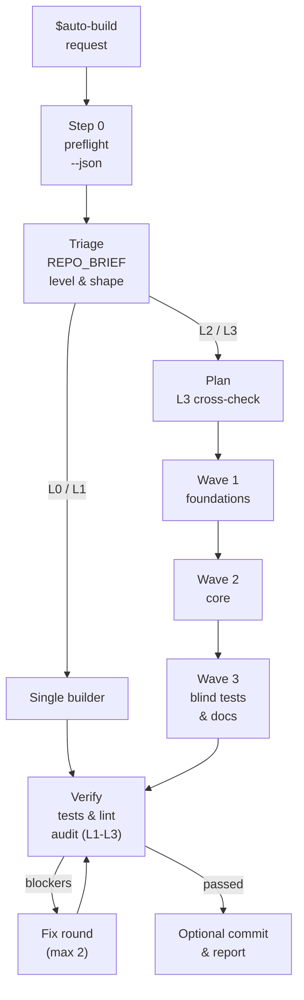

# T3-auto-build

<p align="center"></p>

<p align="center">Cross-platform installer and <code>$auto-build</code> orchestration suite for T3 Code.</p>

<p align="center">
  <a href="https://www.npmjs.com/package/t3-auto-build"></a>
  <a href="https://github.com/mirceas94/T3-auto-build/actions/workflows/ci.yml"></a>
  
  
  
</p>

Type `$auto-build <task>` in T3 Code to plan, build, test, and review a coding task across the AI subscriptions you already pay for. It splits larger tasks into safe parallel steps. All but tiny changes are reviewed by a different model when one is available; tiny edits are self-checked, and `--no-audit` skips review. Before delegating, it checks temporary pauses after quota limits and remaining quota, so work stays away from models you are out of quota on. Built-in safety hooks also block common destructive commands (such as recursive `rm` on broad paths or `git push --force` / `git reset --hard`) and edits to secret files like `.env` or private keys. Hooks only run on Claude sessions (via `~/.claude/settings.json`) and check only Claude's Bash and file-edit tools: PowerShell commands such as `Remove-Item`, and shell writes to `.env`, are not blocked. They are a safety net against common mistakes, not a security sandbox.

## Table of Contents

| Area | Sections |
|---|---|
| **User Guide** | [What you need](#what-you-need) · [Install](#install) · [Your first run](#your-first-run) · [Everyday flags](#everyday-flags) · [FAQ & troubleshooting](#faq--troubleshooting) |
| **Advanced Reference** | [Why & architecture highlights](#advanced-reference) · [Subscription tiers](#subscription-tiers) · [Parent model](#parent-model) · [Cross-hosted overflow](#cross-hosted-overflow) · [Availability checks](#availability-checks) · [Lock rechecks](#lock-rechecks) · [Model drift](#model-drift-safe-by-default) · [Adopting newly released models](#adopting-newly-released-models) · [Catalog overrides](#catalog-overrides) · [Model bans](#model-bans) · [Speed-mode guard](#speed-mode-guard) · [Legacy presets](#legacy-presets) · [Upgrading](#upgrading) · [Migrating from v1](#migrating-from-v1) |
| **Workflow & CLI** | [auto-build workflow](#auto-build-workflow) · [Starting model](#starting-model) · [CLI](#cli) · [Preflight](#preflight) · [Reference text](#reference-text) · [Run ledger](#run-ledger-and-stats) · [doctor --fix](#doctor---fix) · [Modules](#modules) · [sync-models](#sync-models) · [Quota](#quota) · [Quota readers and pace](#quota-readers-and-pace) · [Cooldown file](#cooldown-file) |
| **Config, Hooks & Ops** | [Configuration](#configuration) · [What `init` touches](#what-init-touches) · [Hooks](#hooks) · [Known limits](#known-limits) · [Security and privacy](#security-and-privacy) · [Troubleshooting & common gotchas](#troubleshooting--common-gotchas) · [Optional tools](#optional-tools) · [Development](#development) · [Project structure](#project-structure) · [Credits](#credits) · [License](#license) |

## What you need

- **[T3 Code](https://t3.codes/download)** (also installs cleanly for Claude Code).
- **[Node.js 18.18 or newer](https://nodejs.org/en/download)** (zero third-party dependencies).
- **At least one eligible subscription plan** (pass `none` for any provider you do not use):
  - **Claude:** `pro`, `max`, `ultra`, `team-standard`, `team-premium`, or `api` (`free` cannot run Claude Code; `api` requires `--allow-usage-credits`).
  - **Codex:** `free`, `go`, `plus`, `pro-100`, `pro-200`, `pro-500`, `business`, or `api` (`api` requires `--allow-usage-credits`).
  - **Antigravity:** `free`, `plus`, `pro-trial`, `pro`, `ultra-5x`, or `ultra-20x`.

## Install

1. **Install the CLI and run setup.** Installing globally puts `t3-auto-build` on your `PATH`, which lets the `$auto-build` skill run preflight, quota, and reference commands automatically (without it on `PATH`, the skill falls back to reading cooldown and availability files directly):

   ```sh
   npm install -g t3-auto-build@3.0.0
   t3-auto-build init
   ```

   Prefer not to install globally? Run it directly with `npx`:

   ```sh
   npx t3-auto-build@3.0.0 init
   ```

   `init` asks which plans you have and sets everything up. To skip the prompts, pass your plan IDs directly (for example: `npx t3-auto-build@3.0.0 init --claude-tier max --codex-tier plus --antigravity-tier pro --yes`).

2. **Check the install:**

   ```sh
   npx t3-auto-build@3.0.0 doctor
   ```

3. **Restart T3 Code** (and any open Claude Code sessions). Hooks and `settings.json` only load at startup.

Upgrading from 1.x or 2.x? See [Upgrading](#upgrading) and the [changelog](CHANGELOG.md).

## Your first run

Open a thread in T3 Code and type a task with `$auto-build`:

```text
$auto-build Add a dark-mode toggle to the settings page and add tests for it
```

What you will see:

- **Startup check:** `$auto-build` checks which models are available and not paused after a quota limit.
- **Plan & build:** Small changes go straight to one model; bigger tasks get a short plan and parallel edits across your models.
- **Tests & review:** It runs your project's tests/linter and reviews the changes for bugs (tiny edits are self-checked).
- **Final summary:** You get a report of changed files, test results, review verdict, and which models ran each step.

Nothing is committed to Git unless you pass `--commit` (and even then, only after tests and review pass). If a provider hits a quota limit mid-run, progress is saved in `.claude/auto-build-state.json` — run `$auto-build --resume` later to continue where you left off. Resume before starting another `$auto-build` task in this project; a new run overwrites the saved progress.

## Everyday flags

Add any of these right after `$auto-build` (for example, `$auto-build --budget --commit <task>`):

| Flag | Plain-English effect |
|---|---|
| `--fast` | Skip planning, extra edge-case tests and two-model review; use only for small, low-risk changes. |
| `--strict` | Extra thoroughness: deeper planning, extra edge-case tests, and a two-model review. |
| `--plan-only` | Write the plan and stop before editing any files. |
| `--dry-run` | Show which models would be used without editing your code (still spends a little quota and may write `.claude/repo-profile.md`). |
| `--budget` | Use lighter models; skip the plan cross-check, extra edge-case tests and two-model review. |
| `--audit-only` | Test and review your uncommitted changes, and **edit your files** to fix failures or blocking issues (no new build). Commit or back up first. |
| `--resume` | Pick up an interrupted run (for example, after a quota stop). |
| `--commit` | Commit the finished changes automatically if the checks pass. Don't combine with `--no-tests` or `--no-audit` if you want both checks. |
| `--claude-only`, `--codex-only`, `--antigravity-only` | Use only that provider's models for this run. |

## FAQ & troubleshooting

- **How does it handle quota?** It uses your standard models first and keeps limited premium models only as backup. It pauses a provider or model pool that has 3% or less left, and lifts that pause on the next check if the quota resets early. Add `--budget` to use less quota, or run `npx t3-auto-build@3.0.0 quota status` to see active pauses. When the 12-hour availability cache is stale, `preflight` / `check-models` sends a tiny probe per standard model; if an API key env var (`ANTHROPIC_API_KEY`, `OPENAI_API_KEY`) is set in your shell, provider CLIs may bill probes to your API account.
- **What about privacy?** `t3-auto-build` itself has zero dependencies, makes no network requests, and keeps its caches and run ledger on your machine. It does invoke your installed provider CLIs (`claude`, `codex`, `agy`), which send live prompts and usage checks to those providers using your existing logins.
- **How do I update?** Run `npx t3-auto-build@3.0.0 init --yes` (or, if installed globally, run `npm install -g t3-auto-build@3.0.0`, then `t3-auto-build init --yes`), then restart T3 Code. Your edited files are preserved unless you pass `--force` (which backs them up first). An edited hook file stops `init` until you use `--force`. Coming from 1.x or 2.x? Run `npx t3-auto-build@3.0.0 upgrade` instead (`init --yes` keeps the old config format).
- **How do I uninstall?** Run `npx t3-auto-build@3.0.0 uninstall`, then restart T3 Code. It removes installed files and caches while keeping files you edited, your cooldown file, and your run ledger. If installed globally, also run `npm uninstall -g t3-auto-build`.
- **Why did `doctor` warn about a missing CLI?** Warnings about a provider CLI you only use inside T3 Code (or optional tools like `rg` / `sg`) are informational (exit code `0`) and do not stop `$auto-build` from working. If hooks do not seem active, restart T3 Code.

---

## Advanced reference

The sections below document the full routing model, CLI options, configuration schema, hooks, and internals.

### Highlights

`t3-auto-build` equips T3 Code (and Claude Code) with subscription-aware multi-model routing and
safety guardrails: a coding-discipline `CLAUDE.md`, reusable slash commands (`/fix`, `/review`,
`/handover`), an `auto-build` skill rendered from your own model config, and self-contained Node.js
hooks.

- **Subscription profiles:** tell `init` your Claude, Codex and Antigravity plans; models, ladders and parallelism follow.
- **Parallel waves:** larger tasks are split into file-disjoint waves with checks between them.
- **Guardrails:** hooks block secret-file edits, destructive Git/`rm` commands, and disallowed `delegate_task` calls.
- **Quota aware:** cooldown locks and an availability cache keep delegation away from exhausted or restricted models.
- **Careful installs:** `init` keeps your edited files unless you pass `--force`, which backs them up first.
- **One-call preflight:** [`preflight --json`](#preflight) reports locks, ladders, git baseline and resume state.
- **Smaller context:** the rendered `auto-build` skill is over 70% smaller than in 2.2 (about 5.0 to 6.0 KiB across presets and tiers; the template is ~5.2 KB), with [reference text](#reference-text) loaded on demand. Compaction notes omit empty lines, and unguarded tools skip the guard checks.
- **Run stats and repair:** a local [run ledger](#run-ledger-and-stats) and [`doctor --fix`](#doctor---fix).
- **Zero dependencies:** plain Node, 18.18 or newer.

### Read-only inspection & non-interactive examples

Non-interactive fresh install with explicit tiers (from a clone, use `node bin/cli.mjs` in place of `npx t3-auto-build@3.0.0`):

```sh
npx t3-auto-build@3.0.0 init --claude-tier max --codex-tier plus --antigravity-tier pro --yes
```

`init` prints what it resolved:

```text
provider    | tier | CLI | models (standard)                                    | scarce overflow                    | max parallel
claude      | max  | yes | claude-haiku-5-5, claude-sonnet-5-5, claude-opus-5-5 | claude-fable-5-2                   | 2
codex       | plus | yes | gpt-6-luna, gpt-6.1-terra, gpt-6.1-sol, gpt-6.2-sol  | -                                  | 1
antigravity | pro  | yes | gemini-4-hydrogen, gemini-4-neon, gemini-4-carbon    | claude-sonnet-5-5, claude-opus-5-5 | 2
parent: opus (medium)
max parallel builders: 5
```

> `init --yes` **without** a tier flag on a fresh directory writes a legacy v1
> [preset](#legacy-presets) config, not a subscription profile.

Fill the `12h` availability cache (probes run only when the cache is stale; see
[Availability checks](#availability-checks)):

```sh
npx t3-auto-build@3.0.0 check-models
```

Read-only inspection commands (no config writes, no live probes):

- Active quota cooldown locks: `npx t3-auto-build@3.0.0 quota status`
- Availability cache age, model status, and drift counts: `npx t3-auto-build@3.0.0 availability status`
- Preview model drift promotions without probing or writing: `npx t3-auto-build@3.0.0 sync-models --apply --dry-run`

The skill calls `t3-auto-build ...`. From a clone, `npm link` puts that command on `PATH`.
Without it the skill reads the cooldown and availability files directly.

## Subscription tiers

Pass one or more of `--claude-tier`, `--codex-tier`, and `--antigravity-tier`. When setting tiers,
an omitted provider defaults to `none` on a fresh install, keeps its tier on a tier-based (v2 or v3) config, and gets
the [assumed tier](#migrating-from-v1) on a v1 config. At least one provider needs a CLI-capable
tier.

| Provider | Tier | CLI | Standard models | Scarce overflow | Max parallel | Warning |
|---|---|---|---|---|---|---|
| claude | `none` | no | – | – | 0 | no Claude subscription selected |
| claude | `free` | no | – | – | 0 | Claude Code requires Pro or higher (or api) |
| claude | `pro` | yes | `claude-haiku-5-5`, `claude-sonnet-5-5`, `claude-opus-5-5` | – | 1 | – |
| claude | `max` | yes | `claude-haiku-5-5`, `claude-sonnet-5-5`, `claude-opus-5-5` | `claude-fable-5-2` | 2 | – |
| claude | `ultra` | yes | `claude-haiku-5-5`, `claude-sonnet-5-5`, `claude-opus-5-5` | `claude-fable-5-2` | 3 | – |
| claude | `team-standard` | yes | `claude-haiku-5-5`, `claude-sonnet-5-5`, `claude-opus-5-5` | – | 1 | – |
| claude | `team-premium` | yes | `claude-haiku-5-5`, `claude-sonnet-5-5`, `claude-opus-5-5` | – | 2 | – |
| claude | `api` | yes | `claude-haiku-5-5`, `claude-sonnet-5-5`, `claude-opus-5-5` | `claude-fable-5-2` | 3 | API usage is billed per token |
| codex | `none` | no | – | – | 0 | no Codex subscription selected |
| codex | `free` | yes | `gpt-6-luna`, `gpt-5.6-terra`, `gpt-5.6-luna` | – | 1 | – |
| codex | `go` | yes | `gpt-6-luna`, `gpt-5.6-terra`, `gpt-5.6-luna` | – | 1 | – |
| codex | `plus` | yes | `gpt-6-luna`, `gpt-6.1-terra`, `gpt-6.1-sol`, `gpt-6.2-sol` | – | 1 | – |
| codex | `pro-100` | yes | `gpt-6-luna`, `gpt-6.1-terra`, `gpt-6.1-sol`, `gpt-6.2-sol` | `gpt-6-astra`, `gpt-6.2-astra` | 2 | – |
| codex | `pro-200` | yes | `gpt-6-luna`, `gpt-6.1-terra`, `gpt-6.1-sol`, `gpt-6.2-sol` | `gpt-6-astra`, `gpt-6.2-astra` | 2 | – |
| codex | `pro-500` | yes | `gpt-6-luna`, `gpt-6.1-terra`, `gpt-6.1-sol`, `gpt-6.2-sol` | `gpt-6-astra`, `gpt-6.2-astra` | 3 | – |
| codex | `business` | yes | `gpt-6-luna`, `gpt-6.1-terra`, `gpt-6.1-sol`, `gpt-6.2-sol` | `gpt-6-astra`, `gpt-6.2-astra` | 2 | – |
| codex | `api` | yes | `gpt-6-luna`, `gpt-6.1-terra`, `gpt-6.1-sol`, `gpt-6.2-sol` | `gpt-6-astra`, `gpt-6.2-astra` | 3 | API usage is billed per token |
| antigravity | `none` | no | – | – | 0 | no Antigravity subscription selected |
| antigravity | `free` | yes | `gemini-4-hydrogen`, `gemini-4-neon` | – | 1 | – |
| antigravity | `plus` | yes | `gemini-4-hydrogen`, `gemini-4-neon`, `gemini-4-carbon` | – | 1 | – |
| antigravity | `pro-trial` | yes | `gemini-4-hydrogen`, `gemini-4-neon`, `gemini-4-carbon` | – | 1 | – |
| antigravity | `pro` | yes | `gemini-4-hydrogen`, `gemini-4-neon`, `gemini-4-carbon` | `claude-sonnet-5-5`, `claude-opus-5-5` | 2 | – |
| antigravity | `ultra-5x` | yes | `gemini-4-hydrogen`, `gemini-4-neon`, `gemini-4-carbon` | `claude-sonnet-5-5`, `claude-opus-5-5` | 2 | – |
| antigravity | `ultra-20x` | yes | `gemini-4-hydrogen`, `gemini-4-neon`, `gemini-4-carbon` | `claude-sonnet-5-5`, `claude-opus-5-5` | 3 | – |

- Resolved parallelism is the sum over eligible providers, capped at 6. Builder counts and quota
  windows are estimates.
- `api` tiers are billed per token. Their models are excluded (and listed as plan-restricted)
  unless you pass `--allow-usage-credits`.
- Ladders use native standard models first, interleaving providers. Scarce models come last, as
  overflow or escalation.

### Parent model

The parent is the model of the orchestrating Claude session. It needs an eligible Claude tier.

| Claude tier | Default parent / effort | `--parent` options |
|---|---|---|
| `pro`, `team-standard`, `team-premium` | `sonnet` / `medium` (team-premium: `opus`) | `sonnet`, `opus` |
| `max`, `ultra`, `api` | `opus` / `medium` | `sonnet`, `opus`, `fable` |

An `api` tier counts only with `--allow-usage-credits`.

`--parent fable` selects `claude-fable-5-2`, from the scarce `fable` pool. `init` writes `model` and
`effortLevel` to `settings.json` only when the key is absent or still holds the value it wrote
before. Without an eligible Claude tier, no parent is set. This sets Claude Code's default session
model; in T3 Code you can still start a `$auto-build` thread on any allowlisted model (see
[Starting model](#starting-model)).

### Cross-hosted overflow

Antigravity `pro`, `ultra-5x` and `ultra-20x` also host `claude-sonnet-5-5` and `claude-opus-5-5`,
in the scarce pool `third-party-claude`.

- Reach them in `delegate_task` only with an explicit `provider: "antigravity"` and the unprefixed
  model ID (in config ladders, written as `antigravity:claude-opus-5-5@medium`).
- A bare `claude-*` model always resolves to native Claude, never to Antigravity.
- A model the named provider does not host, or two different providers in one call, is blocked.

## Availability checks

The skill runs [`t3-auto-build preflight`](#preflight) at the start of every run, which runs the same
check as `check-models`. Results go to
`<config dir>/auto-build-availability.json`.

| Check | When | Cost |
|---|---|---|
| 1. Discovery: binary and `--version` check, plus your listing adapters | every `check-models` | no model calls |
| 2. Probes of standard-pool models | cache older than 12 h since the last probe, or `--refresh` | one short prompt per model |
| Scarce-pool probes | never, unless `--probe-scarce` is set and check 2 runs | real scarce quota |
| 3. Reactive marks: `availability mark` after a plan error | on demand | none |

> Probe processes inherit your environment. If an API key variable (such as `ANTHROPIC_API_KEY` or
> `OPENAI_API_KEY`) is set, the CLI may use it and the probes may be billed to the API.

- Probe results never block a model unless they say `plan-restricted`. A failed or timed-out probe
  blocks nothing. A manual mark of `plan-restricted` or `unavailable` blocks.
- A live manual mark beats discovery and probe results. Its `--ttl` is one number plus `m`, `h` or
  `d`, above zero and at most `30d` (default `24h`).
- Antigravity has no probe support.
- After its summary line, `check-models` prints one `provider:model status` line per configured model:
  `available` (nothing speaks against it), `rate-limited` (locked or limited), `plan-restricted`,
  `unavailable` or `skipped-scarce`.

Mark a model manually or inspect the cache:

```sh
t3-auto-build availability mark antigravity:claude-opus-5-5 plan-restricted --ttl 24h --reason "not in plan"
```

```sh
t3-auto-build availability status
```

### Lock rechecks

A lock lasting more than 6 hours gets `setAt` and `recheckAfter` (6 hours later). Once a provider lock
is past `recheckAfter`, or for every provider lock with `--recheck-locks`, `check-models` tests the
cheapest configured standard model:

- With a Claude or Codex CLI installed, it sends one probe. Success clears the lock; any other result
  moves `recheckAfter` 6 hours ahead.
- Otherwise (such as Antigravity) it prints `recheck-via-t3: <provider> (<model>)`. The skill then
  clears the lock, sends a one-word canary `delegate_task`, and re-locks only on a rate limit.

Model and pool locks are not rechecked, though a live quota read can lift a
[threshold lock](#quota-readers-and-pace) early.

```sh
t3-auto-build check-models --recheck-locks
```

### Model drift (safe by default)

Model discovery and drift adoption are conservative by default:

- **`12h` availability cache window:** `check-models` reuses cached probe results for `12h` and
  only re-probes standard-pool models once the cache ages past `12h` (or on `--refresh`). Scarce
  models are never probed unless you pass `--probe-scarce`.
- **Unknown models stay disabled until allowlisted:** Discovery adapters report newly seen IDs and
  missing configured models, but nothing is enabled automatically. Unknown model families stay
  disabled until you explicitly allowlist them in `auto-build.config.json`. Retired, user-banned,
  and plan-restricted IDs are never promoted.
- **Preview before applying:** Run `sync-models --apply --dry-run` first to review proposed
  same-family version upgrades without modifying `auto-build.config.json` or `SKILL.md` (and
  without running live probes).

No provider CLI listing is built in. To detect new or missing models, add an adapter per provider to
the config: an argv array whose stdout is a JSON array or a newline list of model ids.

```json
{ "discovery": { "codex": ["node", "<absolute path>/list-codex-models.mjs"] } }
```

`list-codex-models.mjs` is a placeholder for your own script. Adapters run in an empty temp
directory, so use absolute paths. `check-models` then reports IDs that are not configured and
configured native models the adapter did not list.

1. Refresh discovery and check for drift:

   ```sh
   t3-auto-build check-models
   ```

2. Preview same-family version promotions (no probes, no writes):

   ```sh
   t3-auto-build sync-models --apply --dry-run
   ```

3. Apply promotions (backs up config and re-renders `SKILL.md`):

   ```sh
   t3-auto-build sync-models --apply
   ```

`--apply` reads the availability cache and replaces a configured model with a newer version of the
same family, keeping its pool and ladder position, then backs up the config and re-renders
`SKILL.md` (and any mirrored copies). It needs an `auto-build` or `full` install.

### Adopting newly released models

Newly released models (for example, `claude-opus-5-6` or `claude-sonnet-5-6`) are **never**
enabled automatically — [`pre-tool-use.mjs`](#hooks) enforces the allowlist in
`auto-build.config.json` until you opt in. Choose any of three ways to adopt them:

1. **Same-family drift promotion (with a `discovery` adapter):** Configure a `discovery` script
   above, then run `t3-auto-build check-models`, preview with
   `t3-auto-build sync-models --apply --dry-run`, and apply with `t3-auto-build sync-models --apply`.
   Same-family upgrades are promoted in place; brand-new model families stay disabled until you add
   them manually.
2. **Manual edit (immediate, without waiting for a `t3-auto-build` release):** Edit
   `<config dir>/auto-build.config.json` to update `models`, `allowlist`, `ladders`, and
   `defaultModel`, then re-render `SKILL.md` and all provider mirrors:

   ```sh
   t3-auto-build init --yes
   ```

3. **After a `t3-auto-build` catalog update:** New installs pick up the updated default roster from
   `lib/plans.mjs` automatically. On an existing v2 or v3 config, re-running `init` with the *same* tiers
   intentionally preserves your current `models`, `allowlist`, and `ladders` so custom edits are
   never overwritten; to rebuild from the latest catalog, remove (or back up)
   `auto-build.config.json` and re-run `init` with your tier flags.

## Catalog overrides

`<config dir>/catalog.overrides.json` retires models or adds model name aliases without a package
release. It is your file: `init` does not create or manage it. It needs a `schemaVersion: 3` config, and
`"catalogOverrides": false` turns it off.

```json
{
  "retiredModels": ["gpt-6-astra"],
  "aliases": { "Opus Latest": "claude-opus-5-5" }
}
```

| Key | Effect |
|---|---|
| `retiredModels` | Adds hard bans. Applied by the hooks and to `preflight` ladders. |
| `aliases` | Name to model id, merged under the config's `modelIds` (the config wins). |
| `models` | Validated only (`provider`, `model`, optional `pool`, `scarceQuota`, `family`, `version`, `crossHosted`). **Not yet applied:** add models in the config as described under [Adopting newly released models](#adopting-newly-released-models). |

- It cannot un-retire a built-in retired model, and a retired model cannot be added or aliased.
- An alias cannot form a cycle or link two providers or two built-in models. A `models` entry on a
  provider other than the native one needs `"crossHosted": true`.
- Any validation error drops the whole file except a well-formed `retiredModels` list. A file that is not
  valid JSON is ignored entirely. Both cases print a warning.
- `check-models`, `sync-models`, `SKILL.md` rendering and the runtime snapshot do not read it.

## Model bans

Three layers apply to `delegate_task` calls.

| Layer | Source | Can you remove it? |
|---|---|---|
| Retired | built in, plus `retiredModels` in the config or [overrides](#catalog-overrides) | Not the built-in entries. Both files can only add. |
| Plan-restricted | `planRestrictedModels` (`provider:model` or bare model) and live availability entries | Change tiers, or let the mark expire or replace it |
| User-banned | `userBannedModels` / `bannedModels` | Yes — remove from both lists in `auto-build.config.json`, then re-run `init` |

Built-in retired patterns: `gemini-4-argon`, `gemini-3.8-flash`, `claude-4.6`, `claude-4.6-*`,
`gpt-5.4`, `gpt-5.4-*`, `gpt-5.5`, `gpt-5.5-*`. Matching treats `.` and `-` alike, accepts display
names (`GPT 5.4 Mini`) and ignores a trailing date. A `-*` pattern covers the stem and its suffixed
variants; `gpt-5.40` does not match `gpt-5.4`.

User bans match as case-insensitive substrings, and `A/B` bans both. A short entry such as `Claude`
bans every model whose name contains it.

## Speed-mode guard

Unless the config has `"allowFastModes": true`, a `delegate_task` call is blocked when a key matching
`fast`, `speed` or `serviceTier` is `true`, `fast`, `ultrafast` or `priority`. Set it with
`init --allow-fast-modes`.

## auto-build workflow

Triage sizes the task, `L2`/`L3` plan and build in waves (foundations, core, tests/docs), then verification runs with at most 2 fix rounds.



1. **Step 0:** one [`preflight --json`](#preflight) call checks availability (`12h`-cached) and lock
   rechecks, reads [provider quota](#quota-readers-and-pace), and returns locks, live ladders, the
   `git status` baseline and resume state. When the
   [parent model's](#parent-model) weekly quota is known and under 20%, `preflight` adds a warning
   suggesting `--budget` (without changing the parent; `quota.claudeUsage: false` turns Claude quota off).
   Without the CLI on `PATH`, the skill reads the availability and cooldown files directly.
2. **Triage:** write a short `REPO_BRIEF` (using the cached `.claude/repo-profile.md`) that names
   the top callers of changed interfaces and marks the rest `unverified`, then pick the level `L0` to
   `L3` and work shape `A` (multi-file, UI) or `B` (algorithms, debugging). `L3` covers auth, security,
   payments, databases, concurrency and crypto, plus changes to untrusted-input parsing, filesystem
   path resolution, outbound network calls or secret handling.
3. **Plan** (`L2`/`L3`), cross-checked by another provider on `L3` when available.
4. **Build:** `L2`/`L3` run in file-disjoint waves: foundations, core, tests/docs. Builders in a wave
   run in parallel, at most `maxParallelBuilders` at once; the diff guard and exit checks pass before
   the next wave.
5. **Verify:** blind edge-case tests (`L2`/`L3`), tests and lint, an audit of the task and the diff
   preferring another provider (two auditors on `L3`; any auditor's reproduced `BLOCKER` vetoes
   approval), at most 2 fix rounds (then only a traced, re-verified orchestrator patch of 10 lines or
   fewer, else stop), then an optional commit and a report.

Delegates follow short role rules from `<config dir>/auto-build-rules.md`, installed by `init` and
`upgrade`, refreshed by `sync-models` when it re-renders the skill unless you edited it (same text as [`ref rules`](#reference-text), so it works without the CLI on `PATH`):

- **Auditor:** reports missing, unrequested or wrongly built behavior against the task, and treats
  builder claims as unverified. Anything it cannot settle is marked `UNVERIFIED`, which the
  orchestrator checks before accepting approval (still unsettled items go under `Not checked:`).
- **Fixer:** shows one command failing on the exact symptom before editing, then passing (or says why
  no command can).
- **Tester:** takes expected values from the task, spec or a worked example, not from the code's logic.
- **All delegates:** start no subagents of their own.

State and resuming:

- **Resumable state:** Runs that edit code (plus `--plan-only` runs) save
  `.claude/auto-build-state.json` (`flags`, `completedWaves`, `modifiedFiles`, `remaining`,
  `blockers`) after each wave or step and keep it gitignored.
- **Resuming & quota exhaustion:** `$auto-build --resume` restores saved state (newly typed flags
  win), skips completed waves, and stops if the file is missing or invalid. When quota runs out,
  state is saved so you can resume later.

| Flag | Effect |
|---|---|
| `--fast` / `--strict` | Cap at `L1` / force `L3`. |
| `--plan-only` | Stop after the plan. |
| `--dry-run` | Stop after triage and show the routing. |
| `--audit-only` | Test and audit the uncommitted diff, then fix if needed. |
| `--resume` | Continue an interrupted run. |
| `--commit` | Commit only if the active checks pass. |
| `--no-audit`, `--no-tests` | Skip the audit / tests. |
| `--budget` | Cheaper routing; no plan cross-check, blind tests or dual audit. |
| `--reset-cooldowns` | Clear all locks first. |
| `--<provider>-only` | Use only that provider's models (e.g. `--claude-only`, `--codex-only`, `--antigravity-only`). |

### Starting model

You can start a `$auto-build` conversation in T3 Code on **any allowlisted model** (for example
`gemini-4-neon`), not only the configured Claude [parent model](#parent-model). The starting model
acts as the orchestrator/coordinator: it runs triage, tracks waves and checks, and delegates
builders, testers, and auditors along the configured ladders rather than doing all edits itself.

Choose a starting model that fits the task and your active quotas (check `t3-auto-build check-models`
and `t3-auto-build quota status` to avoid models under active provider locks or plan/availability
restrictions):

| Goal / task type | Practical starting models |
|---|---|
| Saving primary quota, lightweight triage, or small tasks | `gemini-4-neon`, `gpt-6-luna` |
| General multi-file or UI orchestration | `claude-sonnet-5-5`, `gemini-4-neon` |
| Deeper debugging, architecture, or high-risk `L2`/`L3` coordination | `gpt-6.2-sol`, `gpt-6.1-terra`, `gpt-6.1-sol`, `claude-opus-5-5`, `gemini-4-carbon` |

Three practical nuances to keep in mind:

- **Multi-provider skill mirroring:** `init`, `upgrade`, and `sync-models` install the canonical
  `SKILL.md` in `<config dir>/skills/auto-build/SKILL.md` and mirror it to existing provider skill
  directories (`~/.codex/skills`, `~/.agents/skills`, `~/.gemini/config/skills`, and T3 Code
  Antigravity `config/skills` profiles) by default (`--skill-targets auto`). Use
  `--skill-targets none` to disable mirroring or `--skill-targets <dir1>,<dir2>` for explicit
  directories.
- **Hook enforcement scope:** [`pre-tool-use.mjs`](#hooks) is wired through `~/.claude/settings.json`
  and runs on Claude sessions (including Claude delegated children). It enforces model allowlist,
  ban, restriction, speed-mode, and cooldown guards on `delegate_task` calls (plus secret-file and
  destructive-command guards on `Edit`, `Write`, `MultiEdit`, and `Bash`), not on T3 Code's UI
  thread model picker. Non-Claude starting threads (Codex or Antigravity) follow the mirrored
  `SKILL.md` and `t3-auto-build preflight`, but `~/.claude/settings.json` hooks
  do not intercept the non-Claude parent turn itself.
- **Follow-up messages without `$auto-build`:** Subsequent messages in the same thread that omit
  `$auto-build` follow the **Follow-Up Refinement Rule** rather than always launching a fresh full
  `$auto-build` pipeline—questions are answered directly from thread context, `L0` micro-tweaks
  take the fast single-builder path, and only substantive `L1`–`L3` changes re-run the full
  pipeline.

## CLI

```text
t3-auto-build init [options]
t3-auto-build upgrade [--yes]
t3-auto-build preflight [--json] [--flags <text>] [--cwd <dir>] [--refresh]
t3-auto-build ref <flags|cooldowns|state|rules|all>
t3-auto-build check-models [--refresh] [--probe-scarce] [--recheck-locks] [--json]
t3-auto-build sync-models [--auto] [--refresh] [--probe-scarce] [--apply] [--dry-run] [--providers <list>] [--force]
t3-auto-build availability mark <provider:model> <available|plan-restricted|unavailable> [--ttl 24h] [--reason <text>]
t3-auto-build availability status
t3-auto-build quota set <subject> [--pool <name>] [--burst|--5h|--weekly|--until <when>] [--reason <text>]
t3-auto-build quota status
t3-auto-build quota clear <subject> | --all
t3-auto-build quota check [subject] [--refresh] [--on-error] [--claude-usage] [--json]
t3-auto-build trace record <json> | --step <name> [field flags]
t3-auto-build stats [--days <n>] [--json]
t3-auto-build doctor [--fix [--yes]] [--cwd <dir>]
t3-auto-build uninstall
t3-auto-build --version | --help
```

| Command | What it does |
|---|---|
| `init` | Installs or updates. Interactive unless `--yes`. |
| `upgrade` | Converts a v1 or v2 config to schema 3. Never prompts. |
| `preflight` | Runs the model check and prints locks, ladders, baseline and resume state. See [Preflight](#preflight). |
| `ref` | Prints [reference text](#reference-text) for this installation. |
| `trace record`, `stats` | Writes and summarizes the [run ledger](#run-ledger-and-stats). |
| `check-models` | Prunes expired state, runs discovery, probes if the cache is stale. |
| `sync-models` | Probes models and updates the allowlist, or applies drift with `--apply`. |
| `availability mark\|status` | Sets or shows model availability. |
| `quota set\|status\|clear\|check` | Manages cooldown locks; `check` also reads [provider quota](#quota). |
| `doctor` | Checks the installed version, files, config, hook wiring and smoke tests, cache age, configured tiers against CLI binaries, drift and optional tools. [`--fix`](#doctor---fix) plans or applies repairs. |
| `uninstall` | Removes what `init` installed, the availability cache, the quota cache and the runtime snapshot. Keeps files you changed, the cooldown file and the run ledger. |

| Option | Applies to | Meaning |
|---|---|---|
| `--target <dir>` | all | Config directory. Default: `$CLAUDE_CONFIG_DIR`, else `~/.claude`. |
| `-h`, `--help` | all | Show the usage text. |
| `-v`, `--version` | no command | Print the version. |
| `--yes` | init, upgrade, sync-models, `doctor --fix` | No prompts (with `doctor --fix`, apply the repairs). Without an interactive terminal, `init` requires it, and `sync-models` (without `--apply`) requires it, `--auto` or `--dry-run`. |
| `--preset <name>` | init | `tri-provider`, `claude-codex` or `claude-only`. Legacy configs only. |
| `--modules <name>` | init | `full`, `auto-build` or `core`. |
| `--compaction <n>` | init | Integer from 1 to 100. |
| `--tiers <list>` | init | Legacy `provider:plan[:weekday]` list. Ignored for v2/v3 configs. |
| `--claude-tier <tier>` | init | `none`, `free`, `pro`, `max`, `ultra`, `team-standard`, `team-premium`, `api`. |
| `--codex-tier <tier>` | init | `none`, `free`, `go`, `plus`, `pro-100`, `pro-200`, `pro-500`, `business`, `api`. |
| `--antigravity-tier <tier>` | init | `none`, `free`, `plus`, `pro-trial`, `pro`, `ultra-5x`, `ultra-20x`. |
| `--parent <model>` | init | `sonnet`, `opus` or `fable`. See [parent model](#parent-model). |
| `--allow-usage-credits` | init | Include per-token `api` tiers. Needs a tier or a v2/v3 config. |
| `--allow-fast-modes` | init | Permit fast or priority service modes. Needs a tier or a v2/v3 config. |
| `--verified-org` | init | Record `verifiedOrg: true` in a v2/v3 config (informational metadata; not used by routing or hooks). |
| `--skill-targets <mode\|list>` | init | `auto` (default: mirror `SKILL.md` to existing Codex, `.agents`, and T3 Antigravity skill roots), `none`, or comma-separated skill root directories. |
| `--probe` | init | Run `sync-models` after installing. Spends real quota. Ignored for `core`. |
| `--force` | init, sync-models | Back up your changed files to `<file>.bak`, then overwrite. For `sync-models`, this covers a hand-edited `SKILL.md`. |
| `--refresh` | check-models, preflight, sync-models, quota check | Ignore the probe cache TTL (`quota check`: the quota cache). `sync-models` without `--apply` always probes. |
| `--probe-scarce` | check-models, sync-models | Also probe scarce-pool models. |
| `--recheck-locks` | check-models | Recheck every active provider lock now. |
| `--json` | check-models, preflight, stats, quota check | Machine-readable result. |
| `--flags <text>` | preflight | Inline run flags, such as `"--codex-only --dry-run"`. |
| `--cwd <dir>` | preflight, doctor | Project directory. Default: the current one. |
| `--step`, `--model`, `--provider`, `--outcome`, `--level`, `--shape`, `--effort`, `--duration` | trace record | Ledger fields, instead of a JSON argument. |
| `--days <n>` | stats | Window in days, default 30. |
| `--fix` | doctor | Show repairs; add `--yes` to apply them. |
| `--auto` | sync-models | Write without confirmation, like `--yes`. |
| `--apply` | sync-models | Promote newer versions from recorded drift. |
| `--dry-run` | sync-models | With `--apply`, preview drift promotions from the cache (no probes, no writes). Without `--apply`, run live probes (**spends real quota**) and print the result without writing. |
| `--providers <list>` | sync-models | Only these of `claude`, `codex`, `antigravity`; comma separated. |
| `--ttl <duration>` | availability mark | `1m` to `30d`, default `24h`. |
| `--pool <name>` | quota set | Lock a pool: `standard`, `fable`, `astra`, `third-party-claude`, or another lowercase name. |
| `--burst`, `--5h`, `--weekly`, `--until <when>` | quota set | Lock window; one only. Default `--burst`. |
| `--reason <text>` | quota set, availability mark | Note shown by the status command. |
| `--all` | quota clear | Remove every lock. |
| `--on-error` | quota check | Re-read after a quota error and answer `retry` or `failover` (needs a subject). See [Quota](#quota). |
| `--claude-usage` | quota check | Read Claude usage even if `quota.claudeUsage` is `false`. |

Exit codes: `0` success (including informational `doctor` warnings), `1` failure (invalid JSON, broken install), `2` usage error.

```sh
t3-auto-build init --claude-tier pro --codex-tier plus --antigravity-tier pro --parent opus
t3-auto-build check-models --json
t3-auto-build sync-models --refresh --probe-scarce
t3-auto-build quota set antigravity:claude-opus-5-5 --pool third-party-claude
```

### Preflight

```sh
t3-auto-build preflight --json --flags "--codex-only" --cwd .
```

One call for Step 0. It is **not read-only**: like `check-models`, it prunes expired locks, rechecks
due locks, writes the availability cache and probes when that cache is stale or with `--refresh`. Probes
spend quota (see the [API billing warning](#availability-checks)). It also runs the
[quota readers](#quota-readers-and-pace) and writes or lifts threshold locks. It stops on an invalid
config file or an unreadable cooldown file.

| JSON field | Content |
|---|---|
| `version`, `generatedAt` | Result format (`1`) and time. |
| `expiresAt` | `preflight.ttl` from now, or earlier when a lock or restriction lifts. |
| `configHash` | Hash of the config file. Run again if it changes. |
| `subscriptions`, `locks` | Your tiers (`null` on v1) and active cooldowns. |
| `ladders` | Ladders minus non-allowlisted, retired, restricted, unavailable and locked models, scarce pools last, then by quota pace (unknown keeps ladder order). An exhausted ladder is empty. `--<provider>-only` in `--flags` filters them. |
| `quota` | `checkedAt`, `stale`, quota `windows` and pace `scores`. See [Quota](#quota). |
| `canaries` | Locks to recheck through T3 (none with `--dry-run` in `--flags`). |
| `warnings` | Advisory text. The [parent model](#parent-model) has a known weekly quota reading under 20%: it suggests `--budget` and never changes the parent. Empty when unknown or no parent is configured. `quota.claudeUsage: false` turns Claude quota off. |
| `baseline` | `git status --short` lines. |
| `resume` | `null` without `.claude/auto-build-state.json`; else `valid`, `file` and `state` or `error`. |

### Reference text

```sh
t3-auto-build ref cooldowns
```

Topics are `flags` (inline run flags), `cooldowns` (lock keys and the canary recheck), `state` (resume
file and ledger), `rules` (handoff isolation, contract freeze, fix-round limit, audit veto, parent
quota, unverified items, delegate role rules) and
`all`, filled in with your paths and models. `init` and `upgrade` also install the `rules` text as
`<config dir>/auto-build-rules.md`, which the skill reads directly.

### Run ledger and stats

```sh
t3-auto-build trace record --step build --model gpt-6.1-sol --outcome ok --duration 42000
t3-auto-build trace record '{"step":"run","level":"L2"}'
t3-auto-build stats --days 7
```

- Entries go to `<config dir>/auto-build-ledger.jsonl`, which stays on your machine. At
  `telemetry.maxBytes` (default 1 MiB) it rotates to `.1`. `telemetry.enabled: false` turns it off.
- An entry needs a step, model or outcome. The JSON form also accepts `ts` and `failoverFrom`. Quoting
  JSON differs between shells; the field flags work everywhere.
- `stats` reports runs (entries with step `run`), steps, providers, models, failovers, audit rejections
  (outcome containing `reject`) and average step duration. It reads only the current ledger.

### doctor --fix

```sh
t3-auto-build doctor --fix         # show what would change
t3-auto-build doctor --fix --yes   # apply, then check
```

| Repairs | Backup |
|---|---|
| Missing or differing hook files, and their manifest hashes | A changed hook is copied to `.bak`. **Your hook edits are replaced.** |
| Missing or differing `auto-build-rules.md`, and its manifest hash | A changed file is copied to `.bak`. **Your edits are replaced.** |
| Missing or differing `SKILL.md` mirrors | A changed mirror is copied to `.bak`. |
| `auto-build-runtime.json` (v3) | Generated file, no backup. |
| `.claude/auto-build-state.json` entry in the project's git `info/exclude` | Appended only. |
| Identical `SKILL.md` mirror not in the manifest | Not claimed; `init --force` takes ownership. |

It never rewrites `settings.json`, the config, core files or the primary `SKILL.md`; use `init` for those.

### Modules

| `--modules` | Name | CLAUDE.md, rules, commands | Skill, config, hooks, `settings.json` |
|---|---|---|---|
| `full` (default) | Full Suite | yes | yes |
| `auto-build` | /auto-build Only | no | yes |
| `core` | Core Discipline + Commands | yes | no (`settings.json` is not written) |

A re-run without `--modules` keeps the previous choice. When you change it, `init` removes the files
that no longer belong and keeps and reports the ones you changed. Switching to `core` also removes
the hook entries and the values `init` set in `settings.json`. That cleanup is the one case where a
`core` run writes `settings.json`.

## Legacy presets

Without subscription tiers, `init` writes a v1 config from a preset.

| Preset | Models | Codex | Antigravity | Claude | Dual audit |
|---|---|---|---|---|---|
| `tri-provider` (default) | 9 | 3 | 3 | 3 | Claude Opus 5.5 + Gemini 4 Carbon |
| `claude-codex` | 6 | 3 | 0 | 3 | Claude Opus 5.5 + gpt-6-luna |
| `claude-only` | 3 | 0 | 0 | 3 | Claude Opus 5.5 + Claude Sonnet 5.5 |

Every preset defaults to Claude Sonnet 5.5 at `medium` effort and sets the auto-compaction threshold
to 35%. Presets ban no models of their own; the [retired list](#model-bans) always applies.

Interactive `init` on a fresh target suggests tiers (Claude `pro`, Codex `plus`, Antigravity `plus`)
for the `claude`, `codex` and `antigravity` binaries on `PATH`. If you choose `none` everywhere, it
asks for a preset. Provider config folders are only checked for existence. `init --yes` does not
detect: a fresh install without `--preset` or a tier uses `tri-provider`.

`--tiers provider:plan[:weekday]` (for example `claude:max:monday,codex:plus`) records how limits are
shared in a v1 config.

| Provider | Plan: short-window limit locks the provider | Plan: locks only the scarce pool | Pool |
|---|---|---|---|
| `claude` | `pro` | `max` | `fable` |
| `codex` | `plus` | `pro` | `astra` |
| `antigravity` | `standard` | `ultra` | `third-party-claude` |

The weekday (`monday` or `mon`) is the weekly reset day, taken as 00:00 UTC.

## Upgrading

v1 and v2 configs keep loading, with the retired list enforced. One command converts either to
`schemaVersion: 3`:

```sh
npx t3-auto-build@3.0.0 upgrade
```

What `upgrade` does for both:

- Backs up the files it may change, and restores them if a write fails. The config backup (`.bak`,
  `.bak.1` and so on) is kept, as is the `settings.json` backup when that file changes.
- Installs the new hooks. It stops before writing if an installed hook has local changes: run
  `init --force` (which backs them up), then `upgrade` again.
- Re-renders the managed files you have not edited and updates `settings.json`.
- Does nothing on a config that is already schema 3.

Restart T3 Code afterwards. A 2.x package does not understand schema 3 and falls back to default
settings, so restore the config backup if you downgrade.

### From 2.x

Your settings, models and ladders are kept. `schemaVersion` changes, and missing built-in entries are
added to `retiredModels`. The new [config keys](#configuration) use their defaults until you add them.

### Migrating from v1

1. Run `upgrade` as above.

2. `upgrade` assumes low paid tiers, because a v1 config does not say what you pay for: Claude `pro`,
   Codex `plus`, Antigravity `plus` for each provider in your allowlist, else `none`.
3. Set your real tiers:

   ```sh
   npx t3-auto-build@3.0.0 init --claude-tier max --codex-tier pro-200 --antigravity-tier pro
   ```

   Until then no scarce or cross-hosted model is configured.
4. Restart T3 Code.

What the v1 conversion changes:

- Moves your `bannedModels` to `userBannedModels`, dropping the old defaults `Argon` and
  `Fable/Mythos`. `bannedModels` mirrors the list.
- Keeps `compactionThreshold`, `defaultEffort`, `modelIds` and `discovery`. Ladder entries still in
  the new roster stay in place; others are replaced.
- Rebuilds the rest from the tiers. Custom allowlist entries, `defaultModel`, `planRestricted` and
  `tiers` are not carried over.
- Sets `model` and `effortLevel` in `settings.json` when absent.

Existing `tier:<provider>:heavy` cooldown keys are still read.

## sync-models

> **`sync-models --dry-run` (without `--apply`) executes live probes.** It spends real quota and
> writes nothing; the [API billing warning](#availability-checks) applies. To preview drift
> promotions without probing or writing, use `sync-models --apply --dry-run` (see
> [Model drift (safe by default)](#model-drift-safe-by-default)).

- **Candidates:** On a v2 or v3 config, probe candidates come only from your tier-bound `allowlist`
  (preset models are not merged in). On a legacy v1 config, candidates are the config `allowlist`,
  its `planRestricted` models, and the preset's models (`custom` uses `tri-provider`). Banned models
  and, without `--probe-scarce`, scarce models are not probed.
- **Probe execution:** Each candidate gets a one-word prompt through `claude -p` (tools disabled,
  safe mode, no session persistence) or `codex exec` (read-only, ephemeral, `--ignore-user-config`,
  `--ignore-rules`) in an empty temp directory with a 20 s timeout. Antigravity has no probe
  support: its models report `unavailable` and keep their current membership.

| State | Effect on the config |
|---|---|
| `available` | Kept in `allowlist` (on v1, also added from the preset/`planRestricted` and removed from `planRestricted`; on v2/v3, tier-derived `planRestrictedModels` are never lifted by a probe). |
| `rate-limited` | Same as `available`, plus a cooldown (preserving the longest reset time per key across the run). After a provider-wide limit the remaining models of that provider are skipped; a skipped model already in `planRestricted` stays there. |
| `plan-restricted` | Removed from `allowlist` and added to `planRestrictedModels` as `provider:model` (v2/v3) or moved to `planRestricted` (v1). |
| `unavailable` | No change (CLI missing, not logged in, timeout, unsupported or other failure). |

- **Confirmation & backups:** Without `--yes` or `--auto`, `sync-models` (without `--apply`) shows
  the changes and asks before writing. Writes back up a changed config, re-render `SKILL.md`, and
  record cooldowns without shortening longer ones.
- **Safety guards:** A hand-edited `SKILL.md` is skipped with a warning (`--force` backs it up and
  overwrites it). An emptied ladder gets a fallback model; if no allowed model would remain,
  nothing is written.
- **Install scope:** Writing needs an `auto-build` or `full` install; `--dry-run` needs only the
  config file. `init --probe` runs `sync-models --yes` automatically after installing.

## Quota

```sh
t3-auto-build quota set <provider|model|provider:model> [--pool <name>] [--burst|--5h|--weekly|--until <when>] [--reason <text>]
t3-auto-build quota status
t3-auto-build quota clear <provider|model|provider:model>   # or --all
t3-auto-build quota check [subject] [--refresh] [--on-error] [--claude-usage] [--json]
```

- `set claude` locks the provider; `set claude-opus-5-5` locks that model on every hosting;
  `set antigravity:claude-opus-5-5` locks that hosting only. With `--pool`, any of these locks that
  pool of the provider instead (a bare model means its native provider).
- The default `--burst` is 10 minutes; `--5h` is 5 hours; `--weekly` runs to a legacy tier's reset
  day, else 7 days. `--until` takes a future ISO time or a duration such as `90m` or `1w2d`.
- In a v1 config whose `--tiers` plan locks only the scarce pool, `--5h` on a provider locks that
  pool.
- Reset times parsed from rate-limit messages honor explicit `UTC`/`GMT`/`Z` clock suffixes and are
  capped at 14 days. A manual `--until` is not capped.
- `status` drops expired locks and prints the rest.
- `clear <provider>` (or `clear provider:<provider>`) removes its provider and pool locks, not its
  model locks. `clear <model>` removes that model's lock; `clear <provider:model>` removes that
  hosting's model lock (and any matching unqualified model lock). `--all` deletes the file, even a
  corrupt one.
- `check` reads remaining quota via the provider readers below (reusing `auto-build-quota.json`
  while fresh unless `--refresh` or `--on-error` is given), updates the cache, and writes threshold
  auto-locks for windows at or below `quota.minRemainingPct`. A live read also
  [lifts them](#quota-readers-and-pace) when quota is back.

### Quota readers and pace

| Provider | Source | Notes |
|---|---|---|
| Codex | `codex app-server` rate limits | Experimental interface; it may change between Codex versions. |
| Antigravity | `agy -p /usage` (or `antigravity`) | Weekly and five-hour windows for each model pool. |
| Claude | `claude -p /usage --no-session-persistence --safe-mode` | Saves no session and runs no hooks or plugins. Needs a Claude CLI with both flags. Turn off with `quota.claudeUsage: false`. |

- A failed, timed-out (15 s) or unrecognized read is `unknown`; routing then keeps the ladder order.
- Set `T3AB_QUOTA_READERS=off` (also `0` or `false`) to skip spawning provider quota CLIs and treat
  all live reads as `unknown`.
- [Preflight](#preflight) orders eligible ladder entries by pace: the remaining percentage divided by
  the share of the window still to run, lowest across the applicable windows. Scarce pools stay last.
- A window at or below `quota.minRemainingPct` locks its provider or pool until the reset. A longer
  lock is never shortened.
- A later live read (`preflight` or `quota check`) lifts that threshold lock early when every window
  read for it is above the threshold. Manual, probe and burst locks stay until they expire or are cleared.
- `check <provider:model> --on-error`, after a quota error, re-reads. If the reset is under 2 minutes away it
  waits and answers `retry` (retry once). Otherwise it answers `failover` and, when no window is at or
  below the threshold, locks that pool (`tier:<p>:<pool>`) for `quota.burstLockMs` (`0` skips the lock).
- Results are cached in `<config dir>/auto-build-quota.json` without account ids or emails.

### Cooldown file

`<config dir>/auto-build-cooldowns.json` is a JSON object with these keys:

| Key | Locks |
|---|---|
| `model:<id>` | The model on every hosting. |
| `model:<provider>:<id>` | That hosting (or custom instance, such as `model:codex-2:<id>`) only. |
| `provider:<p>` | The provider (or custom instance). Canonical `provider:codex` also covers `codex-2`; `provider:codex-2` covers only `codex-2`. Locking `claude` does not block `antigravity:claude-opus-5-5`. |
| `tier:<p>:<pool>` | One pool (`[a-z0-9-]+`, `standard` included), such as `tier:antigravity:third-party-claude`. Custom instance keys (`tier:codex-2:<pool>`) stay isolated to that instance and do not leak to `codex`. |

On v2 and v3 configs, `quota check` writes `tier:<p>:<pool>` burst locks (the pool may be `standard`) and
threshold locks for antigravity pools; threshold locks for other providers' standard pool are `provider:<p>`.
Probes write `tier:<p>:<pool>` for a scarce pool; a standard-pool limit stays a model or provider lock unless
`tier:<p>:heavy` already holds. Legacy `tier:<p>:heavy` keys are still read
and are gated on provider match so they never leak across hosts. Without a configured `heavyModels`
list they cover the legacy heavy model and the catalog's scarce models of that provider.

```json
{
  "tier:codex:astra": {
    "scope": "tier",
    "tier": "astra",
    "window": "weekly",
    "until": "2030-01-01T05:00:00.000Z",
    "reason": "manual lock (weekly)",
    "source": "manual"
  }
}
```

- **Fields:** `scope` is `model`, `provider` or `tier`; `window` is `burst`, `5h`, `weekly` or
  `custom`. Legacy `until_utc` is read.
- **Long locks & keys:** Locks lasting more than 6 hours also carry `setAt` and `recheckAfter` (see
  [lock rechecks](#lock-rechecks)). A key without a prefix needs a `scope` field, or it locks
  nothing.
- **Malformed data:** A malformed entry (such as one without a valid time) is skipped with a warning
  and kept until overwritten or cleared (`quota clear <name>` or `--all`). A file that is not a JSON
  object is unreadable: hooks warn and ignore it.
- **Cleanup:** A write that leaves no entries removes the file.

## Configuration

`<config dir>/auto-build.config.json`. A tier-based config has `schemaVersion: 3` (v2 configs still load)
and:

| Keys | Meaning |
|---|---|
| `subscriptions`, `parent`, `preset` | Your tiers, parent model and effort, and a label. |
| `models` | `provider`, `model`, `pool`, `scarceQuota`, `family`, `version` per hosting. |
| `allowlist`, `ladders` | Provider to model ids; ordered `[provider:]model[@effort]` lists (`tier1`, `commandRunner`, `builderA`, `testerA`, `auditorA`, `builderB`, `testerB`, `auditorB`, `architect`, `dualAudit`). |
| `retiredModels`, `planRestrictedModels`, `userBannedModels`, `bannedModels` | See [Model bans](#model-bans). |
| `allowFastModes`, `allowUsageCredits`, `verifiedOrg` | Switches, `false` by default. |
| `maxParallelBuilders`, `defaultModel`, `defaultEffort`, `compactionThreshold` | Run settings. |
| `modelIds`, `discovery` | Display name to CLI id; drift adapters. |
| `telemetry` (v3) | `enabled` (default `true`) and `maxBytes` (default `1048576`) of the [run ledger](#run-ledger-and-stats). |
| `quota` | Optional. `minRemainingPct` (default `3`), `ttlMs` (cache lifetime, `300000`), `claudeUsage` (`true`) and `burstLockMs` (`300000`; `0` skips the burst lock). See [Quota](#quota). |
| `preflight` (v3) | `ttl` in milliseconds (default `43200000`) for [preflight](#preflight) `expiresAt`. It does not change the probe cache TTL. |
| `catalogOverrides` (v3) | `false` ignores [`catalog.overrides.json`](#catalog-overrides). Read by default. |

A v1 config has no `schemaVersion` and may also use `tiers` and `planRestricted`.

- The existing file is always the base. Re-run `init` after editing to re-render the skill. The hooks
  read the file when they need it.
- Changing tiers (or usage credits) rebuilds `models`, `allowlist` and `ladders`, after a backup. It
  keeps your bans, switches, `quota` (threshold, cache TTL, `claudeUsage`, burst lock), effort, `modelIds` and `discovery`.
- `--compaction` overrides the file. In a v1 config, a `--preset` that differs from the file's
  replaces the allowlist, ladders and default model and effort. Banned models typed at the prompt are
  added.
- To start over, delete the file and run `init`.
- Model names ignore case and punctuation runs, so `claude-sonnet-5-5` matches `Claude Sonnet 5.5`.
  Provider cooldowns match the provider name or the T3 provider id (`claudeAgent`, `codex`,
  `antigravity`). `provider:codex` also covers a custom instance such as `codex-2`;
  `provider:codex-2`, `tier:codex-2:<pool>` and `model:codex-2:<id>` cover only that instance.
- Keys missing from the file come from its `preset` (`tri-provider` when unset or `custom`). The
  hooks fall back to full defaults on an unknown `schemaVersion`.
- Rendering drops banned and non-allowlisted ladder entries. If a ladder ends up empty, `init` fails
  and writes nothing.
- The skill gets one `--<provider>-only` flag per allowlisted provider.

## What `init` touches

- **Managed files** (in `<config dir>`):
  - **Core (`full`, `core`):** `CLAUDE.md`, `rules/code-quality.md`, `commands/fix.md`, `commands/review.md`, `commands/handover.md`.
  - **Auto-build (`full`, `auto-build`):** `skills/auto-build/SKILL.md`, `auto-build-rules.md` (the `ref rules` text, so the skill reads it without the CLI on `PATH`), `auto-build.config.json`, `hooks/t3-auto-build/{session-start,pre-compact,pre-tool-use,post-tool-use,_shared,_quota,_catalog}.mjs`, `settings.json`, and mirrored `auto-build/SKILL.md` copies in active `--skill-targets` roots.
  - **Manifest (all modules):** `t3-auto-build.manifest.json`.
- **Generated, not in the manifest:** `auto-build-runtime.json` (v3), the availability cache, the quota
  cache (`auto-build-quota.json`) and the run ledger. `uninstall` keeps the ledger.
- Files that exist and differ from what was installed are skipped with a warning. Hook files are the
  exception: a hook with local changes stops `init` with exit code 1 before any write. `--force` backs
  changed files up first (`.bak`, then `.bak.1`, so an earlier backup is never overwritten). An identical
  file that is not in the manifest is never claimed by a plain `init`, `sync-models` or `doctor --fix`;
  `init --force` takes ownership of it, so `uninstall` removes it.
- `settings.json`: only the four tagged hook entries, `env.CLAUDE_AUTOCOMPACT_PCT_OVERRIDE` and, with
  a parent model, `model` and `effortLevel`. Other keys and hooks are preserved. A backup
  (`settings.json.bak`, then `.bak.1`) is written only when the content changes; an identical existing
  backup is reused. Invalid JSON stops the run before any write.
- Paths that go through a symlink or junction inside the config directory are not written or
  deleted. A symlinked `settings.json` is updated through the link. A symlinked `.bak` is skipped, and a
  symlinked manifest is refused.
- `t3-auto-build.manifest.json` records installed file hashes and prior setting values. `uninstall`
  restores a value only if it is still the one installed.
- A target path containing `"`, `$`, a backtick or `%` is refused, because it cannot be quoted
  safely in a hook command.

## Hooks

Installed to `<config dir>/hooks/t3-auto-build/`. Tool and property matching is case-insensitive.

| Hook | Event | Behavior |
|---|---|---|
| `session-start.mjs` | SessionStart | Prints up to 6 lines: subscriptions (or an upgrade hint), active locks, cache freshness, drift counts. Prunes expired cooldowns. |
| `pre-compact.mjs` | PreCompact | Prints the preservation rules (allowlist, bans, restrictions, scarce pools, locks; empty lists are omitted), the saved orchestrator state if present (marked as data only, not instructions), and a `git status --short` snapshot (20 files at most). |
| `pre-tool-use.mjs` | PreToolUse | Exits 2 with a reason when a guard below matches. Unguarded tools (such as `Read`, `Grep`, `Glob`) exit early, after the payload shape check. |
| `post-tool-use.mjs` | PostToolUse | Formats the edited file with `biome` or `prettier` (`.js`, `.jsx`, `.ts`, `.tsx`, `.json`, `.css`, `.md`), `ruff` (`.py`), or `gofmt` (`.go`) when on `PATH`. Never blocks. |

PreToolUse guards:

- **Invalid payload:** a named tool whose `tool_input` is present but not an object is blocked.
- **Secret files** (`Edit`, `Write`, `MultiEdit`): `.env` and `.env.*`, `.pem`, `.key`, `.p12`,
  `.pfx`, and paths containing `id_rsa` or `id_ed25519`.
- **Git** (`Bash`): `git push --force`/`-f`, a `+ref` refspec push, and `git reset --hard`,
  including after git global options such as `-C` or `-c`.
- **Recursive `rm`** (`Bash`; `-r`, `-rf`, `-fr`, `-r -f`, `--recursive`; `-f` not required): blocked
  when a target starts with `/`, `\`, `~`, a drive path such as `C:/`, `$HOME` or `%USERPROFILE%`;
  contains a command substitution or a brace list such as `{a,b}`; is a bare variable, the current
  directory or `*`; has a `..` or `.git` segment; or is a dot-file glob such as `.*`. A command too
  costly to scan is also blocked.
- **Delegate calls** (`delegate_task`), in order: [speed mode](#speed-mode-guard), provider/model
  conflict, retired, user-banned, plan-restricted, availability, per-provider allowlist (a trailing
  `-YYYYMMDD` suffix is ignored), then cooldown locks.

Empty or unparsable hook input, and unreadable cooldown data, produce exit 0 (fail open). An invalid
config value produces a warning and a default, so the allowlist is still enforced. The secret and
destructive-command guards need no config.

### Known limits

- The command guards cover the `Bash` tool only and use simple patterns. They are a safety net, not a
  sandbox.
- The `rm` guard matches text. Obfuscated `rm`, PowerShell removal commands such as `Remove-Item`, and
  `find -delete` are **not** caught. Other variables are not expanded. Harmless text can match:
  `echo rm -rf .` is blocked. A very long command with many `rm` calls is blocked unchecked; split it up.
- Force flags after `git push` (`-f`, `--force…`) and `+ref` refspecs are blocked, including
  `--force-with-lease`. A branch name such as `bug-fix` is not.
- The delegate guard reads `model` and the provider fields (`provider`, `providerInstanceId`,
  `driverKind`) at the top level of `tool_input` and under `target` (T3 Code's shape). A call without
  a model skips the model checks; the speed-mode guard and provider cooldowns still apply.
- No `Stop` hook is installed.
- Legacy PowerShell hooks (`safety-guard.ps1`, `post-format.ps1`, `pre-compact.ps1`,
  `session-start.ps1`): if still wired in `settings.json` from an earlier local setup, remove them so
  both sets do not run; `doctor` warns while they remain wired.

## Security and privacy

- No runtime dependencies. The package's own code makes no network requests. The
  [run ledger](#run-ledger-and-stats) is a local file that is never sent anywhere.
- It does run provider CLIs, which may use the network: `check-models`, `preflight`, `sync-models` and
  `init --probe` send live prompts, `check-models` and `preflight` also run their `--version` and your `discovery`
  commands. `quota check` and `preflight` run the
  [quota readers](#quota-readers-and-pace) (`codex app-server`, `agy -p /usage` and, unless you turn it
  off, `claude -p /usage`). The quota cache keeps no account ids or emails.
- `discovery` commands run with your permissions. Add only commands you trust.
- Provider detection only checks that config folders exist; it opens nothing inside them.
- Probes run in an empty temp directory, and the cooldown reasons they record never quote CLI output.
- Commands are resolved from absolute `PATH` entries, never the current directory.
- Install and uninstall protect your edits and refuse symlinked paths inside the config directory,
  with the exceptions described in [What `init` touches](#what-init-touches).
- Guard hooks have [known limits](#known-limits). Do not rely on them as a security boundary.

Report vulnerabilities as described in [SECURITY.md](https://github.com/mirceas94/T3-auto-build/blob/main/SECURITY.md). To contribute,
see [CONTRIBUTING.md](https://github.com/mirceas94/T3-auto-build/blob/main/CONTRIBUTING.md).

## Troubleshooting & Common Gotchas

- **Informational `doctor` warnings (missing optional provider CLIs):** `doctor` checks `PATH` for
  the CLI binary of every provider whose tier is not `none`, as well as optional tools, and exits
  `0` when only warnings are present (`1` only on failures). Warnings about missing provider CLIs
  you do not invoke locally (for example, `antigravity` or a CLI you only use through T3 Code) are
  informational and do not stop `$auto-build` from running. If you do not use a provider at all,
  set its tier to `none` with `init` to clear the warning.
- **Optional search and formatter tools (`rg`, `sg`, `PostToolUse` formatters):** `rg` (ripgrep)
  and `sg` (ast-grep) are optional—`doctor` warns when they are absent, and install commands are
  below in [Optional tools](#optional-tools). The `post-tool-use.mjs` hook formats edited files
  using `biome`, `prettier`, `ruff`, or `gofmt` when present on `PATH`; if none are installed, it
  silently skips formatting and never blocks edits.
- **Keep repo-specific scripts and Actions in your project, not in `~/.claude/`:** Files under
  `~/.claude/` (or `$CLAUDE_CONFIG_DIR`) are managed by `t3-auto-build` and tracked in
  `t3-auto-build.manifest.json`. Keep project-specific scripts, custom `discovery` adapters, and
  GitHub Actions workflows inside your repositories rather than editing managed `~/.claude/` files;
  hand-edited managed files are skipped with warnings on `init`/`upgrade`, and an edited hook file
  stops the run (`init --force` backs them up to `.bak` and overwrites them).
- **Keep local runtime state and cache files gitignored:** Per-repo orchestrator state
  (`.claude/auto-build-state.json`, `.claude/repo-profile.md`) and local cache/lock/backup files
  (`auto-build-cooldowns.json`, `auto-build-availability.json`, `auto-build-quota.json`, `auto-build-ledger.jsonl`, `*.bak`) are machine-local runtime
  artifacts. Keep them in `.gitignore` so personal cooldowns, availability caches, and in-progress
  wave state are never committed.

## Optional tools

`doctor` warns when these are missing:

| Tool | Windows | macOS | Linux |
|---|---|---|---|
| ripgrep (`rg`) | `winget install BurntSushi.ripgrep.MSVC` | `brew install ripgrep` | `apt install ripgrep` |
| ast-grep (`sg`) | `winget install ast-grep.ast-grep` | `brew install ast-grep` | `npm i -g @ast-grep/cli` |

[Context7](https://github.com/upstash/context7) is also optional and not checked by `doctor`. When its
MCP tools are available, `$auto-build` builders use them to verify third-party library APIs. It is a
third-party network service that you set up yourself.

## Development

`sandbox()` in `test/helpers.mjs` overrides `HOME`, `USERPROFILE`, `APPDATA`, `LOCALAPPDATA`,
`CLAUDE_CONFIG_DIR`, `PATH` (stripped of provider CLI shims) and `T3AB_QUOTA_READERS=off` for
spawned CLI/hook subprocesses, and overrides `PATH`, `T3AB_QUOTA_READERS`, `APPDATA` and
`LOCALAPPDATA` in-process. Because `process.env.HOME` and `process.env.USERPROFILE` are not
overridden in-process, a bare `node --test` can let in-process `upgrade()` or `syncModels()` tests
mirror `SKILL.md` into your real home skill directories. Run tests with a temporary home directory
outside the repository and `T3AB_QUOTA_READERS=off`:

```sh
# macOS / Linux
tmp="$(mktemp -d)" && HOME="$tmp" USERPROFILE="$tmp" APPDATA="$tmp/roaming" LOCALAPPDATA="$tmp/local" T3AB_QUOTA_READERS=off node --test; rm -rf "$tmp"
```

```powershell
# Windows (PowerShell). Run in a new window and close it afterwards: it changes HOME.
$tmp = Join-Path ([System.IO.Path]::GetTempPath()) ("t3ab-test-" + [guid]::NewGuid().ToString("N"))
New-Item -ItemType Directory -Path $tmp | Out-Null
$env:HOME=$tmp; $env:USERPROFILE=$tmp; $env:APPDATA="$tmp\roaming"; $env:LOCALAPPDATA="$tmp\local"; $env:T3AB_QUOTA_READERS="off"
node --test --test-reporter=spec
Remove-Item -Recurse -Force $tmp
```

### Project structure

| Path | Content |
|---|---|
| `bin/cli.mjs` | Command parsing and dispatch. |
| `hooks/` | Installed hooks. `_catalog.mjs` (models, retired list, overrides), `_shared.mjs` (config, guards), `_quota.mjs` (cooldowns). |
| `lib/plans.mjs`, `lib/render.mjs` | Subscription catalog, ladder resolution and `SKILL.md` rendering. |
| `lib/quota.mjs`, `lib/quota/usage.mjs` | Quota CLI (`set`, `status`, `clear`, `check`), pace scoring and provider usage readers. |
| `lib/install/` | `plan.mjs` (validate, plan), `write.mjs` (install, uninstall), `upgrade.mjs` (staged upgrade). `lib/install.mjs` re-exports. |
| `lib/discover/` | `sources.mjs` (adapters, id parsing), `merge.mjs` (checks, drift), `cache.mjs` (availability file). `lib/discover.mjs` re-exports. |
| `lib/preflight.mjs`, `lib/ref.mjs`, `lib/telemetry.mjs` | `preflight`, `ref`, `trace record` and `stats`. |
| `lib/doctor.mjs`, `lib/mirrors.mjs`, `lib/probe.mjs`, `lib/settings.mjs`, `lib/manifest.mjs`, `lib/detect.mjs`, `lib/paths.mjs`, `lib/prompt.mjs` | Diagnostics/repair, skill mirroring, model probing, `settings.json` merging, manifest, provider detection, path safety and prompts. |
| `core/`, `skills/`, `presets/` | Installed instructions, skill template and legacy presets. |

## Credits

Some of the audit, testing, debugging and triage rules in `$auto-build` are inspired by
[superpowers](https://github.com/obra/superpowers) by Jesse Vincent,
[mattpocock/skills](https://github.com/mattpocock/skills) by Matt Pocock and
[ECC](https://github.com/affaan-m/ECC) by Affaan Mustafa (all MIT). The wording is our own, and
`t3-auto-build` does not require any of them.

## License

MIT
