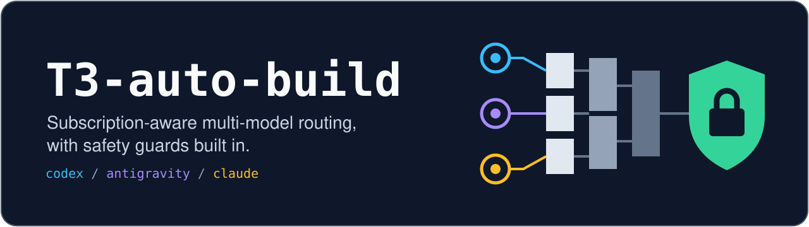
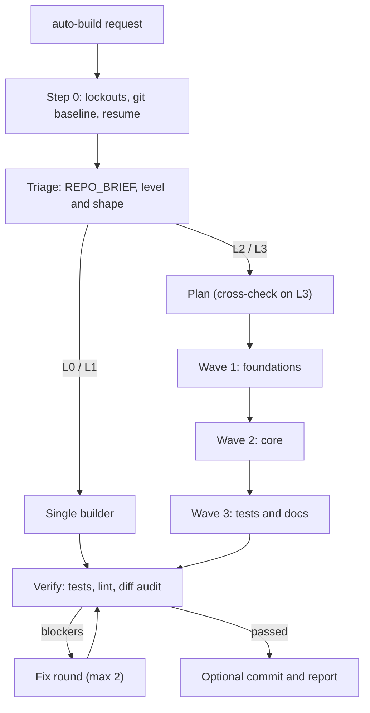

# t3-auto-build

<p align="center"></p>

<p align="center">Cross-platform installer and <code>$auto-build</code> orchestration suite for T3 Code.</p>

<p align="center">
  <a href="https://www.npmjs.com/package/t3-auto-build"></a>
  <a href="https://github.com/mirceas94/t3-auto-build/actions/workflows/ci.yml"></a>
  
  
  
</p>

## Why t3-auto-build

Cross-platform installer and `$auto-build` orchestration suite for T3 Code: a coding-discipline
`CLAUDE.md`, slash commands, an `auto-build` skill rendered from your own model config, and Node
hooks for guardrails. No dependencies. Node 18.18 or newer.

- **Subscription profiles:** tell `init` your Claude, Codex and Antigravity plans; models, ladders and parallelism follow.
- **Parallel waves:** larger tasks are split into file-disjoint waves with checks between them.
- **Guardrails:** hooks block secret-file edits, some destructive commands and disallowed delegate calls.
- **Quota aware:** cooldown locks and an availability cache keep delegation away from exhausted or restricted models.
- **Careful installs:** your edited files are kept unless you pass `--force`, which backs them up first.
- **Zero dependencies:** plain Node, 18.18 or newer.

Upgrading from 1.x? Read [Migrating from v1](#migrating-from-v1) and the [changelog](CHANGELOG.md).

## 60-second Quick Start

1. Install into your Claude config directory, naming your plans (see the [tier matrix](#subscription-tiers)):

   ```sh
   npx t3-auto-build init --claude-tier max --codex-tier plus --antigravity-tier pro --yes
   ```

   Plain `npx t3-auto-build init` asks instead. From a clone, use `node bin/cli.mjs` in place of
   `npx t3-auto-build`. `init` prints what it resolved:

   ```text
   provider    | tier | CLI | models (standard)                                    | scarce overflow                    | max parallel
   claude      | max  | yes | claude-haiku-5-5, claude-sonnet-5-5, claude-opus-5-5 | -                                  | 2
   codex       | plus | yes | gpt-6-luna, gpt-6.1-terra                            | -                                  | 1
   antigravity | pro  | yes | gemini-4-hydrogen, gemini-4-neon, gemini-4-carbon    | claude-sonnet-5-5, claude-opus-5-5 | 2
   parent: opus (medium)
   max parallel builders: 5
   ```

   > `init --yes` **without** a tier flag on a fresh directory writes a legacy v1
   > [preset](#legacy-presets) config, not a subscription profile.

2. Check the installation and fill the availability cache:

   ```sh
   npx t3-auto-build doctor
   npx t3-auto-build check-models
   ```

   `check-models` sends real prompts when its cache is stale. See [availability](#availability-checks).

3. **Restart T3 Code** (and any running Claude Code session). Hooks and `settings.json` changes
   load only at startup.

4. In a T3 Code thread, run `$auto-build <task>`. See [workflow](#auto-build-workflow) for flags.

The skill calls `t3-auto-build ...`. From a clone, `npm link` puts that command on `PATH`.
Without it the skill reads the cooldown and availability files directly.

## Subscription tiers

Pass `--claude-tier`, `--codex-tier` and `--antigravity-tier`. An omitted provider is `none` on a
fresh install, keeps its tier on a v2 config, and gets the [assumed tier](#migrating-from-v1) on a
v1 config. At least one provider needs a CLI-capable tier.

| Provider | Tier | CLI | Standard models | Scarce overflow | Max parallel | Warning |
|---|---|---|---|---|---|---|
| claude | `none` | no | – | – | 0 | no Claude subscription selected |
| claude | `free` | no | – | – | 0 | Claude Code requires Pro or higher (or api) |
| claude | `pro` | yes | `claude-haiku-5-5`, `claude-sonnet-5-5`, `claude-opus-5-5` | – | 1 | – |
| claude | `max` | yes | `claude-haiku-5-5`, `claude-sonnet-5-5`, `claude-opus-5-5` | – | 2 | – |
| claude | `ultra` | yes | `claude-haiku-5-5`, `claude-sonnet-5-5`, `claude-opus-5-5` | `claude-fable-5-2` | 3 | – |
| claude | `team-standard` | yes | `claude-haiku-5-5`, `claude-sonnet-5-5`, `claude-opus-5-5` | – | 1 | – |
| claude | `team-premium` | yes | `claude-haiku-5-5`, `claude-sonnet-5-5`, `claude-opus-5-5` | – | 2 | – |
| claude | `api` | yes | `claude-haiku-5-5`, `claude-sonnet-5-5`, `claude-opus-5-5` | `claude-fable-5-2` | 3 | API usage is billed per token |
| codex | `none` | no | – | – | 0 | no Codex subscription selected |
| codex | `free` | no | – | – | 0 | desktop-only; Codex CLI unavailable |
| codex | `go` | no | – | – | 0 | desktop-only; Codex CLI unavailable |
| codex | `plus` | yes | `gpt-6-luna`, `gpt-6.1-terra` | – | 1 | – |
| codex | `pro-100` | yes | `gpt-6-luna`, `gpt-6.1-terra`, `gpt-6.1-sol` | `gpt-6-astra` | 2 | – |
| codex | `pro-200` | yes | `gpt-6-luna`, `gpt-6.1-terra`, `gpt-6.1-sol` | `gpt-6-astra` | 2 | – |
| codex | `pro-500` | yes | `gpt-6-luna`, `gpt-6.1-terra`, `gpt-6.1-sol` | `gpt-6-astra` | 3 | – |
| codex | `business` | yes | `gpt-6-luna`, `gpt-6.1-terra`, `gpt-6.1-sol` | `gpt-6-astra` | 2 | – |
| codex | `api` | yes | `gpt-6-luna`, `gpt-6.1-terra`, `gpt-6.1-sol` | `gpt-6-astra` | 3 | API usage is billed per token |
| antigravity | `none` | no | – | – | 0 | no Antigravity subscription selected |
| antigravity | `free` | yes | `gemini-4-hydrogen`, `gemini-4-neon` | – | 1 | – |
| antigravity | `plus` | yes | `gemini-4-hydrogen`, `gemini-4-neon`, `gemini-4-carbon` | – | 1 | – |
| antigravity | `pro-trial` | yes | `gemini-4-hydrogen`, `gemini-4-neon`, `gemini-4-carbon` | – | 1 | – |
| antigravity | `pro` | yes | `gemini-4-hydrogen`, `gemini-4-neon`, `gemini-4-carbon` | `claude-sonnet-5-5`, `claude-opus-5-5` | 2 | – |
| antigravity | `ultra-5x` | yes | `gemini-4-hydrogen`, `gemini-4-neon`, `gemini-4-carbon` | `claude-sonnet-5-5`, `claude-opus-5-5` | 2 | – |
| antigravity | `ultra-20x` | yes | `gemini-4-hydrogen`, `gemini-4-neon`, `gemini-4-carbon` | `claude-sonnet-5-5`, `claude-opus-5-5` | 3 | – |

- Resolved parallelism is the sum over eligible providers, capped at 6. Builder counts and quota
  windows are estimates.
- `api` tiers are billed per token. Their models are excluded (and listed as plan-restricted)
  unless you pass `--allow-usage-credits`.
- Ladders use native standard models first, interleaving providers. Scarce models come last, as
  overflow or escalation.

### Parent model

The parent is the model of the orchestrating Claude session. It needs an eligible Claude tier.

| Claude tier | Default parent / effort | `--parent` options |
|---|---|---|
| `pro`, `team-standard` | `sonnet` / `medium` | `sonnet`, `opus` |
| `max`, `team-premium` | `opus` / `medium` | `sonnet`, `opus` |
| `ultra`, `api` | `opus` / `medium` | `sonnet`, `opus`, `fable` |

An `api` tier counts only with `--allow-usage-credits`.

`--parent fable` selects `claude-fable-5-2`, from the scarce `fable` pool. `init` writes `model` and
`effortLevel` to `settings.json` only when the key is absent or still holds the value it wrote
before. Without an eligible Claude tier, no parent is set.

### Cross-hosted overflow

Antigravity `pro`, `ultra-5x` and `ultra-20x` also host `claude-sonnet-5-5` and `claude-opus-5-5`,
in the scarce pool `third-party-claude`.

- Reach them only with an explicit `provider: "antigravity"` (ladders write
  `antigravity:claude-opus-5-5@medium`).
- A bare `claude-*` model always resolves to native Claude, never to Antigravity.
- A model the named provider does not host, or two different providers in one call, is blocked.

## Availability checks

The skill runs `t3-auto-build check-models` at the start of every run. Results go to
`<config dir>/auto-build-availability.json`.

| Check | When | Cost |
|---|---|---|
| 1. Discovery: binary and `--version` check, plus your listing adapters | every `check-models` | no model calls |
| 2. Probes of standard-pool models | cache older than 12 h since the last probe, or `--refresh` | one short prompt per model |
| Scarce-pool probes | never, unless `--probe-scarce` is set and check 2 runs | real scarce quota |
| 3. Reactive marks: `availability mark` after a plan error | on demand | none |

> Probe processes inherit your environment. If an API key variable (such as `ANTHROPIC_API_KEY` or
> `OPENAI_API_KEY`) is set, the CLI may use it and the probes may be billed to the API.

- Probe results never block a model unless they say `plan-restricted`. A failed or timed-out probe
  blocks nothing. A manual mark of `plan-restricted` or `unavailable` blocks.
- A live manual mark beats discovery and probe results. Its `--ttl` is one number plus `m`, `h` or
  `d`, above zero and at most `30d` (default `24h`).
- Antigravity has no probe support.

```sh
t3-auto-build availability mark antigravity:claude-opus-5-5 plan-restricted --ttl 24h --reason "not in plan"
t3-auto-build availability status
```

### Model drift

No provider CLI listing is built in. To detect new or missing models, add an adapter per provider to
the config: an argv array whose stdout is a JSON array or a newline list of model ids.

```json
{ "discovery": { "codex": ["node", "<absolute path>/list-codex-models.mjs"] } }
```

`list-codex-models.mjs` is a placeholder for your own script. Adapters run in an empty temp
directory, so use absolute paths. `check-models` then reports ids that
are not configured, and configured native models the adapter did not list. Nothing is allowed
automatically. To adopt newer versions:

```sh
t3-auto-build check-models
t3-auto-build sync-models --apply
```

`--apply` runs no probes. It reads the availability cache and replaces a configured model with a
newer version of the same family, keeping its pool and ladder position. Retired, banned and
plan-restricted ids are never promoted; unknown families are reported and stay disabled. It backs up
the config and re-renders `SKILL.md`. It needs an `auto-build` or `full` install.

## Model bans

Three layers apply to `delegate_task` calls.

| Layer | Source | Can you remove it? |
|---|---|---|
| Retired | built in, plus `retiredModels` | Not the built-in entries. Config can only add. |
| Plan-restricted | `planRestrictedModels` (`provider:model` or bare model) and live availability entries | Change tiers, or let the mark expire or replace it |
| User-banned | `userBannedModels` / `bannedModels` | Yes, edit both lists in the config |

Built-in retired patterns: `gemini-4-argon`, `gemini-3.8-flash`, `claude-4.6`, `claude-4.6-*`,
`gpt-5.4`, `gpt-5.4-*`, `gpt-5.5`, `gpt-5.5-*`. Matching treats `.` and `-` alike, accepts display
names (`GPT 5.4 Mini`) and ignores a trailing date. A `-*` pattern covers the stem and its suffixed
variants; `gpt-5.40` does not match `gpt-5.4`.

User bans match as case-insensitive substrings, and `A/B` bans both. A short entry such as `Claude`
bans every model whose name contains it.

## Speed-mode guard

Unless the config has `"allowFastModes": true`, a `delegate_task` call is blocked when a key matching
`fast`, `speed` or `serviceTier` is `true`, `fast`, `ultrafast` or `priority`. Set it with
`init --allow-fast-modes`.

## auto-build workflow

Triage sizes the task, `L2`/`L3` plan and build in waves (foundations, core, tests/docs), then verification runs with at most 2 fix rounds.



1. **Step 0:** run `t3-auto-build check-models`, check lockouts and restrictions, record the
   `git status` baseline, resume if asked.
2. **Triage:** write a short `REPO_BRIEF` (using the cached `.claude/repo-profile.md`) and pick the
   level `L0` to `L3` and work shape `A` (multi-file, UI) or `B` (algorithms, debugging).
3. **Plan** (`L2`/`L3`), cross-checked by another provider on `L3` when available.
4. **Build:** `L2`/`L3` run in file-disjoint waves: foundations, core, tests/docs. Builders in a wave
   run in parallel, at most `maxParallelBuilders` at once; the diff guard and exit checks pass before
   the next wave.
5. **Verify:** blind edge-case tests (`L2`/`L3`), tests and lint, a diff-only audit preferring
   another provider (two auditors on `L3`), at most 2 fix rounds, then an optional commit and a
   report.

Runs that edit code, and `--plan-only` runs, save `.claude/auto-build-state.json` (`flags`,
`completedWaves`, `modifiedFiles`, `remaining`, `blockers`) after each wave or step and keep it
gitignored. `$auto-build --resume` restores it, lets newly typed flags win and skips completed waves.
It stops if the file is missing or invalid. When quota runs out, the run saves state so you can
resume later.

| Flag | Effect |
|---|---|
| `--fast` / `--strict` | Cap at `L1` / force `L3`. |
| `--plan-only` | Stop after the plan. |
| `--dry-run` | Stop after triage and show the routing. |
| `--audit-only` | Test and audit the uncommitted diff, then fix if needed. |
| `--resume` | Continue an interrupted run. |
| `--commit` | Commit only if the active checks pass. |
| `--no-audit`, `--no-tests` | Skip the audit / tests. |
| `--budget` | Cheaper routing; no plan cross-check, blind tests or dual audit. |
| `--reset-cooldowns` | Clear all locks first. |
| `--<provider>-only` | Use only that provider's models. |

## CLI

```text
t3-auto-build init
t3-auto-build upgrade [--yes]
t3-auto-build check-models [--refresh] [--probe-scarce] [--json]
t3-auto-build sync-models [--auto] [--refresh] [--probe-scarce] [--apply]
t3-auto-build availability mark <provider:model> <available|plan-restricted|unavailable> [--ttl 24h] [--reason <text>]
t3-auto-build availability status
t3-auto-build quota set <subject>
t3-auto-build quota status
t3-auto-build quota clear [subject]
t3-auto-build quota check [provider]
t3-auto-build doctor
t3-auto-build uninstall
```

| Command | What it does |
|---|---|
| `init` | Installs or updates. Interactive unless `--yes`. |
| `upgrade` | Converts a v1 config to v2. Never prompts. |
| `check-models` | Prunes expired state, runs discovery, probes if the cache is stale. |
| `sync-models` | Probes models and updates the allowlist, or applies drift with `--apply`. |
| `availability mark\|status` | Sets or shows model availability. |
| `quota set\|status\|clear\|check` | Manages cooldown locks. |
| `doctor` | Checks files, config, hook wiring, cache age, tiers against CLI binaries, drift and optional tools. |
| `uninstall` | Removes what `init` installed and the availability cache. Keeps files you changed and the cooldown file. |

| Option | Applies to | Meaning |
|---|---|---|
| `--target <dir>` | all | Config directory. Default: `$CLAUDE_CONFIG_DIR`, else `~/.claude`. |
| `-h`, `--help` | all | Show the usage text. |
| `-v`, `--version` | no command | Print the version. |
| `--yes` | init, upgrade, sync-models | No prompts. Without an interactive terminal, `init` requires it, and `sync-models` requires it, `--auto` or `--dry-run`. |
| `--preset <name>` | init | `tri-provider`, `claude-codex` or `claude-only`. Legacy configs only. |
| `--modules <name>` | init | `full`, `auto-build` or `core`. |
| `--compaction <n>` | init | Integer from 1 to 100. |
| `--tiers <list>` | init | Legacy `provider:plan[:weekday]` list. Ignored for v2 configs. |
| `--claude-tier <tier>` | init | `none`, `free`, `pro`, `max`, `ultra`, `team-standard`, `team-premium`, `api`. |
| `--codex-tier <tier>` | init | `none`, `free`, `go`, `plus`, `pro-100`, `pro-200`, `pro-500`, `business`, `api`. |
| `--antigravity-tier <tier>` | init | `none`, `free`, `plus`, `pro-trial`, `pro`, `ultra-5x`, `ultra-20x`. |
| `--parent <model>` | init | `sonnet`, `opus` or `fable`. See [parent model](#parent-model). |
| `--allow-usage-credits` | init | Include per-token `api` tiers. Needs a tier or a v2 config. |
| `--allow-fast-modes` | init | Permit fast or priority service modes. Needs a tier or a v2 config. |
| `--verified-org` | init | Record `verifiedOrg: true` in a v2 config. No routing or hook reads it. |
| `--probe` | init | Run `sync-models` after installing. Spends real quota. Ignored for `core`. |
| `--force` | init, sync-models | Back up your changed files to `<file>.bak`, then overwrite. For `sync-models`, this covers a hand-edited `SKILL.md`. |
| `--refresh` | check-models, sync-models | Ignore the probe cache TTL. `sync-models` without `--apply` always probes. |
| `--probe-scarce` | check-models, sync-models | Also probe scarce-pool models. |
| `--json` | check-models | Machine-readable result. |
| `--auto` | sync-models | Write without confirmation, like `--yes`. |
| `--apply` | sync-models | Promote newer versions from recorded drift. |
| `--dry-run` | sync-models | Probe and print the result; write nothing. **Still spends real quota.** |
| `--providers <list>` | sync-models | Only these of `claude`, `codex`, `antigravity`; comma separated. |
| `--ttl <duration>` | availability mark | `1m` to `30d`, default `24h`. |
| `--pool <name>` | quota set | Lock a pool: `standard`, `fable`, `astra`, `third-party-claude`, or another lowercase name. |
| `--burst`, `--5h`, `--weekly`, `--until <when>` | quota set | Lock window; one only. Default `--burst`. |
| `--reason <text>` | quota set, availability mark | Note shown by the status command. |
| `--all` | quota clear | Remove every lock. |

Exit codes: `0` success, `1` failure (invalid JSON, broken install), `2` usage error.

```sh
t3-auto-build init --claude-tier pro --codex-tier plus --antigravity-tier pro --parent opus
t3-auto-build check-models --json
t3-auto-build sync-models --refresh --probe-scarce
t3-auto-build quota set antigravity:claude-opus-5-5 --pool third-party-claude
```

### Modules

| `--modules` | Name | CLAUDE.md, rules, commands | Skill, config, hooks, `settings.json` |
|---|---|---|---|
| `full` (default) | Full Suite | yes | yes |
| `auto-build` | /auto-build Only | no | yes |
| `core` | Core Discipline + Commands | yes | no (`settings.json` is not written) |

A re-run without `--modules` keeps the previous choice. When you change it, `init` removes the files
that no longer belong and keeps and reports the ones you changed. Switching to `core` also removes
the hook entries and the values `init` set in `settings.json`. That cleanup is the one case where a
`core` run writes `settings.json`.

## Legacy presets

Without subscription tiers, `init` writes a v1 config from a preset.

| Preset | Models | Codex | Antigravity | Claude | Dual audit |
|---|---|---|---|---|---|
| `tri-provider` (default) | 9 | 3 | 3 | 3 | Claude Opus 5.5 + Gemini 4 Carbon |
| `claude-codex` | 6 | 3 | 0 | 3 | Claude Opus 5.5 + gpt-6-luna |
| `claude-only` | 3 | 0 | 0 | 3 | Claude Opus 5.5 + Claude Sonnet 5.5 |

Every preset defaults to Claude Sonnet 5.5 at `medium` effort and sets the auto-compaction threshold
to 35%. Presets ban no models of their own; the [retired list](#model-bans) always applies.

Interactive `init` on a fresh target suggests tiers (Claude `pro`, Codex `plus`, Antigravity `plus`)
for the `claude`, `codex` and `antigravity` binaries on `PATH`. If you choose `none` everywhere, it
asks for a preset. Provider config folders are only checked for existence. `init --yes` does not
detect: a fresh install without `--preset` or a tier uses `tri-provider`.

`--tiers provider:plan[:weekday]` (for example `claude:max:monday,codex:plus`) records how limits are
shared in a v1 config.

| Provider | Plan: short-window limit locks the provider | Plan: locks only the scarce pool | Pool |
|---|---|---|---|
| `claude` | `pro` | `max` | `fable` |
| `codex` | `plus` | `pro` | `astra` |
| `antigravity` | `standard` | `ultra` | `third-party-claude` |

The weekday (`monday` or `mon`) is the weekly reset day, taken as 00:00 UTC.

## Migrating from v1

v1 configs keep loading, with the retired list enforced. To convert:

1. Run the v2 package:

   ```sh
   npx t3-auto-build@latest upgrade
   ```

2. `upgrade` assumes low paid tiers, because a v1 config does not say what you pay for: Claude `pro`,
   Codex `plus`, Antigravity `plus` for each provider in your allowlist, else `none`.
3. Set your real tiers:

   ```sh
   npx t3-auto-build init --claude-tier max --codex-tier pro-200 --antigravity-tier pro
   ```

   Until then no scarce or cross-hosted model is configured.
4. Restart T3 Code.

What `upgrade` does:

- Backs up `auto-build.config.json` to `.bak` (`.bak.1` and so on if a different backup exists).
- Moves your `bannedModels` to `userBannedModels`, dropping the old defaults `Argon` and
  `Fable/Mythos`. `bannedModels` mirrors the list.
- Keeps `compactionThreshold`, `defaultEffort`, `modelIds` and `discovery`. Ladder entries still in
  the new roster stay in place; others are replaced.
- Rebuilds the rest from the tiers. Custom allowlist entries, `defaultModel`, `planRestricted` and
  `tiers` are not carried over.
- Re-renders the managed files you have not edited and updates `settings.json`, including `model` and
  `effortLevel` when absent.
- Does nothing on a config that is already v2.

Existing `tier:<provider>:heavy` cooldown keys are still read.

## sync-models

> **`sync-models --dry-run` still executes live probes.** It spends real quota and writes nothing.
> The [API billing warning](#availability-checks) applies.

Candidates are the config allowlist, its `planRestricted` models and the preset's models (a `custom`
config uses the `tri-provider` preset). Banned models and, without `--probe-scarce`, scarce models
are not probed. Each other model gets a one-word prompt through `claude -p` or `codex exec`, in an
empty temp directory with a 20 s timeout. `claude` runs with tools disabled, safe mode and no session
persistence. `codex` runs read-only and ephemeral with `--ignore-user-config` and `--ignore-rules`,
so your Codex user config does not apply. Antigravity has no probe support: its models report
`unavailable` and keep their current membership.

> On a v2 config, preset models count as candidates too. A successful probe can therefore add
> allowlist entries beyond your tier, including display-name duplicates. Review the changes before you
> confirm, or use `check-models` with `sync-models --apply`.

| State | Effect on the config |
|---|---|
| `available` | Added to or kept in `allowlist`; removed from `planRestricted`. |
| `rate-limited` | Same as `available`, plus a cooldown. After a provider-wide limit the remaining models of that provider are skipped; a skipped model already in `planRestricted` stays there. |
| `plan-restricted` | Moved from `allowlist` to `planRestricted`. |
| `unavailable` | No change (CLI missing, not logged in, timeout, unsupported or other failure). |

Without `--yes` it shows the changes and asks before writing. A write backs up a changed config,
re-renders `SKILL.md` and records cooldowns without shortening longer ones. A hand-edited `SKILL.md`
is skipped with a warning; `--force` backs it up and overwrites it. An emptied ladder gets a
fallback model. If no allowed model would remain, nothing is written.
Writing needs an `auto-build` or `full` install; `--dry-run` needs only the config file.
`init --probe` runs the same sync after installing, asking first unless `--yes`.

## Quota

```sh
t3-auto-build quota set <provider|model|provider:model> [--pool <name>] [--burst|--5h|--weekly|--until <when>] [--reason <text>]
t3-auto-build quota status
t3-auto-build quota clear <provider|model|provider:model>   # or --all
t3-auto-build quota check [provider]
```

- `set claude` locks the provider; `set claude-opus-5-5` locks that model on every hosting;
  `set antigravity:claude-opus-5-5` locks that hosting only. With `--pool`, any of these locks that
  pool of the provider instead (a bare model means its native provider).
- The default `--burst` is 10 minutes; `--5h` is 5 hours; `--weekly` runs to a legacy tier's reset
  day, else 7 days. `--until` takes a future ISO time or a duration such as `90m` or `1w2d`.
- In a v1 config whose `--tiers` plan locks only the scarce pool, `--5h` on a provider locks that
  pool.
- Reset times parsed from rate-limit messages are capped at 14 days. A manual `--until` is not capped.
- `status` drops expired locks and prints the rest.
- `clear <provider>` removes its provider and pool locks, not its model locks. `clear <model>`
  removes that model's lock. `--all` deletes the file, even a corrupt one.
- `check` runs `claude auth status` and `codex login status` (Antigravity has no status command). It
  reports login state only, unless the output explicitly says usage is exhausted; only then does it
  record a lock.

### Cooldown file

`<config dir>/auto-build-cooldowns.json` is a JSON object with these keys:

| Key | Locks |
|---|---|
| `model:<id>` | The model on every hosting. |
| `model:<provider>:<id>` | That hosting only. |
| `provider:<p>` | The provider. Locking `claude` does not block `antigravity:claude-opus-5-5`. |
| `tier:<p>:<pool>` | One pool (`[a-z0-9-]+`), such as `tier:antigravity:third-party-claude`. |

Legacy `tier:<p>:heavy` keys are still read, and `quota check` or a probe may still write them.

```json
{
  "tier:codex:astra": {
    "scope": "tier",
    "tier": "astra",
    "window": "weekly",
    "until": "2030-01-01T05:00:00.000Z",
    "reason": "manual lock (weekly)",
    "source": "manual"
  }
}
```

`scope` is `model`, `provider` or `tier`. `window` is `burst`, `5h`, `weekly` or `custom`. Legacy
`until_utc` is read. A key without a prefix needs a `scope` field, or it locks nothing. A malformed
entry (such as one without a valid time) is skipped with a warning and kept in the file until it is
overwritten or cleared (`quota clear <name>` or `--all`). A file that is not a JSON object is
unreadable: hooks warn and ignore it. A write that leaves no entries removes the file.

## Configuration

`<config dir>/auto-build.config.json`. A v2 config has `schemaVersion: 2` and:

| Keys | Meaning |
|---|---|
| `subscriptions`, `parent`, `preset` | Your tiers, parent model and effort, and a label. |
| `models` | `provider`, `model`, `pool`, `scarceQuota`, `family`, `version` per hosting. |
| `allowlist`, `ladders` | Provider to model ids; ordered `[provider:]model[@effort]` lists. |
| `retiredModels`, `planRestrictedModels`, `userBannedModels`, `bannedModels` | See [Model bans](#model-bans). |
| `allowFastModes`, `allowUsageCredits`, `verifiedOrg` | Switches, `false` by default. |
| `maxParallelBuilders`, `defaultModel`, `defaultEffort`, `compactionThreshold` | Run settings. |
| `modelIds`, `discovery` | Display name to CLI id; drift adapters. |

A v1 config has no `schemaVersion` and may also use `tiers` and `planRestricted`.

- The existing file is always the base. Re-run `init` after editing to re-render the skill. The hooks
  read the file when they need it.
- Changing tiers (or usage credits) rebuilds `models`, `allowlist` and `ladders`, after a backup. It
  keeps your bans, switches, threshold, effort, `modelIds` and `discovery`.
- `--compaction` overrides the file. In a v1 config, a `--preset` that differs from the file's
  replaces the allowlist, ladders and default model and effort. Banned models typed at the prompt are
  added.
- To start over, delete the file and run `init`.
- Model names ignore case and punctuation runs, so `claude-sonnet-5-5` matches `Claude Sonnet 5.5`.
  Provider cooldowns match the provider name or the T3 provider id (`claudeAgent`, `codex`,
  `antigravity`). `provider:codex` also covers a custom instance such as `codex-2`;
  `provider:codex-2` covers only that instance.
- Keys missing from the file come from its `preset` (`tri-provider` when unset or `custom`). The
  hooks fall back to full defaults on an unknown `schemaVersion`.
- Rendering drops banned and non-allowlisted ladder entries. If a ladder ends up empty, `init` fails
  and writes nothing.
- The skill gets one `--<provider>-only` flag per allowlisted provider.

## What `init` touches

- Files that exist and differ from what was installed are skipped with a warning. This includes hook
  files, which are still wired. `--force` backs them up first (`.bak`, then `.bak.1`, so an earlier
  backup is never overwritten).
- `settings.json`: only the four tagged hook entries, `env.CLAUDE_AUTOCOMPACT_PCT_OVERRIDE` and, with
  a parent model, `model` and `effortLevel`. Other keys and hooks are preserved. `settings.json.bak`
  is written only when the content changes. Invalid JSON stops the run before any write.
- Paths that go through a symlink or junction inside the config directory are not written or
  deleted. A symlinked `settings.json` is updated through the link.
- `t3-auto-build.manifest.json` records installed file hashes and prior setting values. `uninstall`
  restores a value only if it is still the one installed.
- A target path containing `"`, `$`, a backtick or `%` is refused, because it cannot be quoted
  safely in a hook command.

## Hooks

Installed to `<config dir>/hooks/t3-auto-build/`. Matching is case-insensitive.

| Hook | Event | Behavior |
|---|---|---|
| `session-start.mjs` | SessionStart | Prints up to 6 lines: subscriptions (or an upgrade hint), active locks, cache freshness, drift counts. Prunes expired cooldowns. |
| `pre-compact.mjs` | PreCompact | Prints the preservation rules (allowlist, bans, restrictions, scarce pools, locks), the saved orchestrator state if present (marked as data only, not instructions), and a `git status --short` snapshot (20 files at most). |
| `pre-tool-use.mjs` | PreToolUse | Exits 2 with a reason when a guard below matches. |
| `post-tool-use.mjs` | PostToolUse | Formats the edited file with `biome` or `prettier`, `ruff`, or `gofmt` when on `PATH`. Never blocks. |

PreToolUse guards:

- **Invalid payload:** a named tool whose `tool_input` is present but not an object is blocked.
- **Secret files** (`Edit`, `Write`, `MultiEdit`): `.env` and `.env.*`, `.pem`, `.key`, `.p12`,
  `.pfx`, and paths containing `id_rsa` or `id_ed25519`.
- **Git** (`Bash`): `git push --force`/`-f` and `git reset --hard`.
- **Recursive `rm`** (`Bash`; `-r`, `-rf`, `-fr`, `-r -f`, `--recursive`; `-f` not required): blocked
  when a target starts with `/`, `\`, `~`, a drive path such as `C:/`, `$HOME` or `%USERPROFILE%`;
  contains a command substitution; is the current directory or `*`; has a `..` or `.git` segment; or
  is a dot-file glob such as `.*`.
- **Delegate calls** (`delegate_task`), in order: [speed mode](#speed-mode-guard), provider/model
  conflict, retired, user-banned, plan-restricted, availability, allowlist (a trailing `-YYYYMMDD`
  suffix is ignored), then cooldown locks.

Empty or unparsable hook input, and unreadable cooldown data, produce exit 0 (fail open). An invalid
config value produces a warning and a default, so the allowlist is still enforced. The secret and
destructive-command guards need no config.

### Known limits

- The command guards cover the `Bash` tool only and use simple patterns. They are a safety net, not a
  sandbox.
- The `rm` guard matches text. Obfuscated `rm`, PowerShell removal commands such as `Remove-Item`, and
  `find -delete` are **not** caught. Other variables are not expanded. Harmless text can match:
  `echo rm -rf .` is blocked. A very long command with many `rm` calls is blocked unchecked; split it up.
- Any `-f` text after `git push` matches, including a branch name such as `bug-fix`.
  `--force-with-lease` is blocked too.
- The delegate guard reads `model` and the provider fields at the top level of `tool_input` and under
  `target` (T3 Code's shape). A call without a model skips the model checks; the speed-mode guard and
  provider cooldowns still apply.

Not ported from the PowerShell hooks: `stop-verify.js`, `bash-guard.js`, `tsc-check.js`, the caveman status line and
skillspector. No Stop hook is installed.

If you already run the PowerShell versions, remove them from `settings.json`. `doctor` warns while
they are still wired.

## Security and privacy

- No runtime dependencies. The package's own code makes no network requests and has no telemetry.
- It does run provider CLIs, which may use the network: `check-models`, `sync-models` and
  `init --probe` send live prompts, `check-models` also runs their `--version` and your `discovery`
  commands, and `quota check` runs their login status commands.
- `discovery` commands run with your permissions. Add only commands you trust.
- Provider detection only checks that config folders exist; it opens nothing inside them.
- Probes run in an empty temp directory, and the cooldown reasons they record never quote CLI output.
- Commands are resolved from absolute `PATH` entries, never the current directory.
- Install and uninstall protect your edits and refuse symlinked paths inside the config directory,
  with the exceptions described in [What `init` touches](#what-init-touches).
- Guard hooks have [known limits](#known-limits). Do not rely on them as a security boundary.

Report vulnerabilities as described in [SECURITY.md](https://github.com/mirceas94/t3-auto-build/blob/main/SECURITY.md). To contribute,
see [CONTRIBUTING.md](https://github.com/mirceas94/t3-auto-build/blob/main/CONTRIBUTING.md).

## Optional tools

`doctor` warns when these are missing:

| Tool | Windows | macOS | Linux |
|---|---|---|---|
| ripgrep (`rg`) | `winget install BurntSushi.ripgrep.MSVC` | `brew install ripgrep` | `apt install ripgrep` |
| ast-grep (`sg`) | `winget install ast-grep.ast-grep` | `brew install ast-grep` | `npm i -g @ast-grep/cli` |

## Development

```sh
node --test
```

Tests run in temporary directories with `HOME`, `USERPROFILE` and `CLAUDE_CONFIG_DIR` overridden.

## License

MIT
